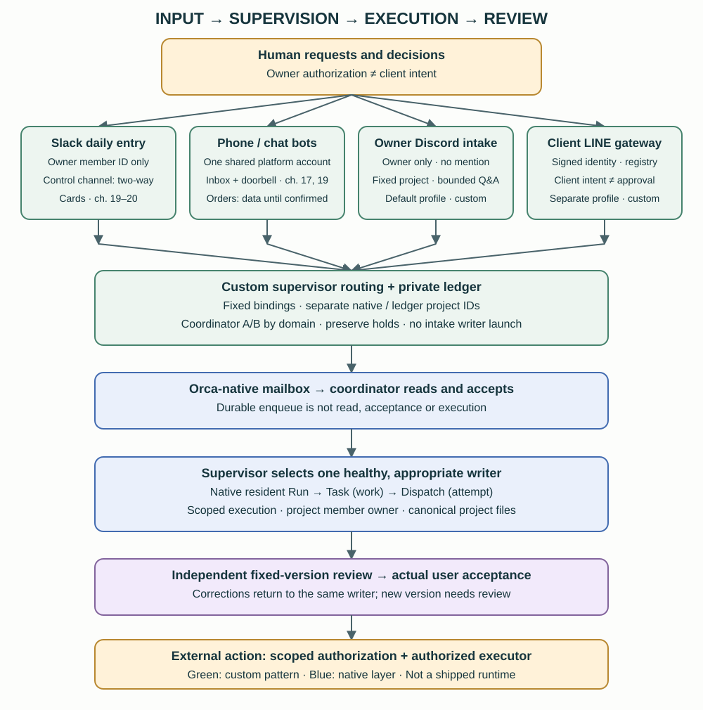
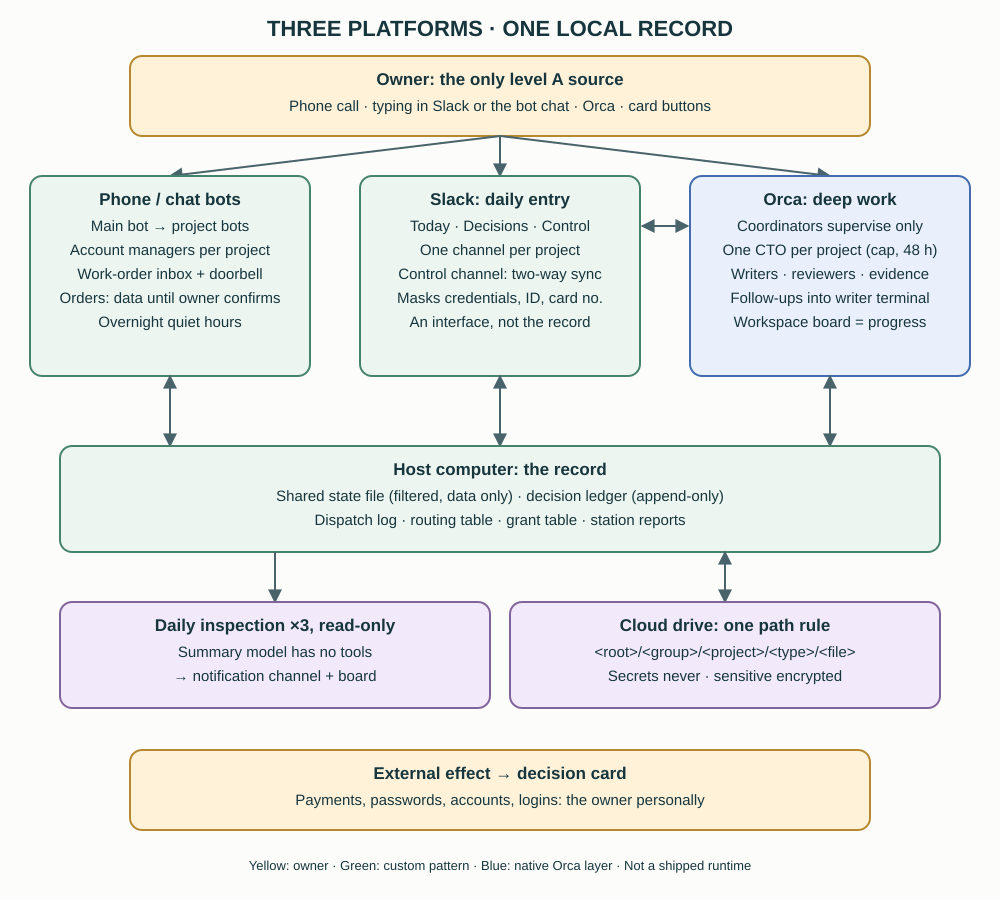

<p align="center"><strong>ORCA / COORDINATION HANDBOOK</strong></p>

# Many agents. Clear ownership.

**A practical handbook for running a personal AI workspace with two coordinators, one writer per deliverable, and evidence before acceptance.**

**English** · [繁體中文](README.zh-TW.md)

[Read the handbook](docs/en/01-overview.md) · [Download a release](https://github.com/rick-ray-wldd/orca-coordination-handbook/releases/latest) · [Use this template](https://github.com/rick-ray-wldd/orca-coordination-handbook/generate)




**2026-11 three-platform update:** the reference now runs on Orca for deep work, a private Slack workspace as the daily entry, and a two-way phone/chat bot platform. [Chapter 19](docs/en/19-three-platforms.md) covers who does what on each platform, the Slack control channel's two-way sync, the bot work-order inbox and doorbell, quiet hours and one shared state file. [Chapter 20](docs/en/20-authority-and-decisions.md) covers source levels A–D, decision cards (one owner, append-only ledger, overdue reminders that link back, withdrawal) and where standing grants end. [Chapter 21](docs/en/21-project-operations.md) covers one CTO per project, dispatch announcements and follow-ups, the read-only daily inspection, the Orca board, the cloud-drive path rule and same-evening records. Five new copy-ready templates use fictional values only.



**Main-source updates:** [Chapter 16](docs/en/16-dedicated-project-intake.md) adds owner-only Discord course/project intake: fixed bindings, bounded Q&A, receipts and coordinator mailbox handoff. [Chapter 17](docs/en/17-entry-channels.md) adds multi-bot entry channels: a channel registry, per-channel desks and outboxes, and why a channel label is not authentication. [Chapter 18](docs/en/18-responsive-coordinators.md) adds keeping coordinators responsive: mailbox read discipline, a session guard, a desk escalation ladder, responsiveness health, voice-fragment merging and a “remind me” pattern. Chapters 19–21 are described above. The historical **v1.0.0** release ZIP/HTML/PDF does not include these updates; read or build from current `main` sources. No new release is created for these updates.

## What you can reuse

| Understand | Put into practice | Adapt |
|---|---|---|
| 20 chapters + capability appendix | 19 templates per language | Four-domain starter routing |
| Twelve diagrams per language | Safe private-workspace initializer | Document-first adoption path |
| Complete English and Traditional Chinese editions | Offline HTML and printable PDF in releases | Translation and contribution guide |

The handbook separates **Orca-native features**, **private reference automation**, **written conventions**, and **unknowns**. It does not pretend a prompt rule is a security boundary.

This is an independent community publication, **not an official Orca product or endorsement**. Orca and the agent CLIs are installed separately. The private reference assistant/database/scheduler is **not included**. The included helper only copies templates.

## Start in one minute

Requires Git and Python **3.10+**. Copying templates needs no AI account, API key or Orca installation.

```sh
git clone https://github.com/rick-ray-wldd/orca-coordination-handbook.git
cd orca-coordination-handbook
python3 scripts/init_workspace.py --dest ../my-assistant --language en
```

For Traditional Chinese:

```sh
python3 scripts/init_workspace.py --dest ../my-assistant-zh --language zh-TW
```

The destination must be new. The helper refuses existing destinations and destinations inside this public repository. It copies files, creates no services, invokes no agents, and never reads credentials.

1. Open the generated `README.md` and replace the placeholders in your private rules and routing.
2. Start a coordinator session in that private folder using your preferred agent CLI.
3. Add a second coordinator, assign distinct supervisor/reviewer roles, then follow [chapter 8](docs/en/08-adoption.md).

**No Python?** Download the [release ZIP](https://github.com/rick-ray-wldd/orca-coordination-handbook/releases/latest), extract it, and copy your chosen language's templates manually using chapter 8. To create your own GitHub copy, click **Use this template**; keep personal working data in a separate private folder.

## The workflow in five decisions

| 1 | 2 | 3 | 4 | 5 |
|---|---|---|---|---|
| Quick read-only answer | Existing healthy idle session | New session in a project | Isolated worktree | New project |

Declare the choice → identify the domain supervisor → assign one writer with explicit scope → require evidence → review a fixed version → record acceptance separately from external actions.

**2026-10 update:** writers run as supervised Orca workers under one resident Run per coordinator; rule changes travel by mailbox; hard safety boundaries and stricter “don't sound finished” acceptance rules; and an optional client message intake gateway. A desktop agent product for non-sensitive work is documented as under evaluation only.

## Read by goal

- **Understand the architecture:** [2. Roles](docs/en/02-architecture.md), [3. Identities](docs/en/03-concepts.md).
- **Assign work consistently:** [4. Dispatch/routing](docs/en/04-dispatch-routing.md), [5. Scope/permissions](docs/en/05-writer-scope-permissions.md).
- **Track real completion:** [6. Evidence/review](docs/en/06-lifecycle-review.md), [7. Operations](docs/en/07-operations.md).
- **Adopt it:** [8. Getting started](docs/en/08-adoption.md), [9. Worked examples](docs/en/09-examples.md), [10. Templates](docs/en/10-templates-guide.md).
- **Go further:** [14. Native orchestration](docs/en/14-native-orchestration.md) (one resident Run per coordinator, supervised workers, mailbox rule sync), [15. Client intake gateway](docs/en/15-client-intake-gateway.md) (allowlist, tool-less replies, preview-only edits), [17. Multi-bot entry channels](docs/en/17-entry-channels.md) (channel registry, desks, one writer per outbox), [18. Responsive coordinators](docs/en/18-responsive-coordinators.md) (inbox delivery, escalation ladder, reminders).
- **Run three platforms:** [19. Orca, Slack and a phone/chat bot](docs/en/19-three-platforms.md), [20. Source levels and decision cards](docs/en/20-authority-and-decisions.md), [21. CTOs, inspection, board, cloud paths and records](docs/en/21-project-operations.md).
- **Maintain it:** [11. Troubleshooting](docs/en/11-troubleshooting.md), [12. Privacy](docs/en/12-pre-share-checklist.md), [Capability matrix](docs/en/13-capability-matrix.md).

## Repository layout

```text
docs/{en,zh-TW}/       Full handbook; stable matching chapter filenames
templates/{en,zh-TW}/  Copy-ready rules, routing, dispatch, review and handoff
diagrams/{en,zh-TW}/   Twelve accessible SVG diagrams per edition
scripts/               Initializer, validation, offline build and packaging
tests/                 Safe-copy behavior tests
locales.json           Default language and locale directories
```

Every chapter links to its counterpart. English is the primary edition; Traditional Chinese is a complete companion. [Translation policy](TRANSLATIONS.md) explains how to add another language and keep changes aligned.

## Validate and build

Core checks use only Python's standard library:

```sh
python3 scripts/validate.py
python3 -m unittest discover -s tests -v
```

Optional document build:

```sh
python3 -m venv .venv
# macOS/Linux; Windows: .venv\Scripts\activate
source .venv/bin/activate
python3 -m pip install -r requirements-build.txt
python3 scripts/build.py
# PDF also needs Chrome/Chromium installed; pass its executable explicitly:
python3 scripts/build.py --pdf --browser "/path/to/chrome-or-chromium"
python3 scripts/package.py --version v1.0.0
```

Open `dist/handbook-en.html` or `dist/handbook-zh-TW.html` directly in a browser. The language switch works when both files are kept together. HTML embeds its diagrams and styles and needs no network assets. PDF rendering uses a temporary, isolated browser profile, not your signed-in profile. Outputs and caches are ignored by Git; releases contain ready-built files.

## Privacy, version and reuse

- Examples use placeholders; the repository contains no personal task database, transcripts or credentials.
- The generic validator is a baseline, not a detector for your identity. Review your own adaptation using the [privacy checklist](docs/en/12-pre-share-checklist.md), including Git history.
- Native examples were reviewed against **Orca CLI 1.4.220**. Check your installed help before copying commands; Linux executable naming differs.
- [MIT licensed](LICENSE). You may copy, modify and redistribute while retaining the notice.
- Contributions: [CONTRIBUTING](CONTRIBUTING.md). Privacy reports: [SECURITY](SECURITY.md).
