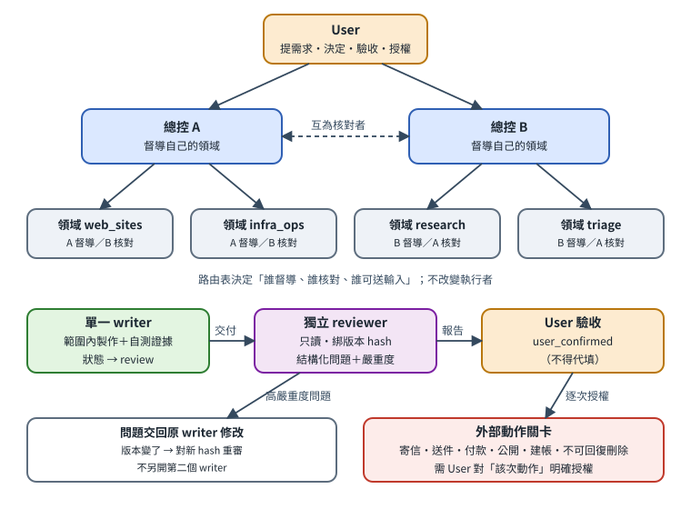

# 多個 agents，清楚的分工

**Orca 個人雙總控工作流程教學手冊：每份產物一位 writer，以證據核對交付，分開記錄使用者驗收。**

[English](README.md) · **繁體中文**

[開始閱讀](docs/zh-TW/01-overview.md) · [下載完整版本](https://github.com/rick-ray-wldd/orca-coordination-handbook/releases/latest) · [複製成自己的 repo](https://github.com/rick-ray-wldd/orca-coordination-handbook/generate)



本 repo 提供完整英文與繁體中文：12 個主章節、能力對照附錄、每種語言 13 份模板及 6 張圖。內容清楚區分 Orca 原生、自製參考工具、人工規約和未知事項。

這是**獨立社群教材，非 Orca 官方產品或背書**。Orca／代理 CLI 需自行安裝，私人參考部署的資料庫、`assistant.py` 與排程未附；初始化工具只會複製模板。

## 一分鐘開始

需要 Git 與 Python **3.10+**，複製模板不需模型帳號、API key 或 Orca。

```sh
git clone https://github.com/rick-ray-wldd/orca-coordination-handbook.git
cd orca-coordination-handbook
python3 scripts/init_workspace.py --dest ../my-assistant --language zh-TW
```

英文模板把 `--language` 改成 `en`。目的地必須尚不存在，且不能放在本公開 repo 裡；工具拒絕覆寫既有資料。不啟動代理、不設定服務、不讀取金鑰。

1. 開啟新資料夾的 README，替換規則及路由中的佔位字。
2. 在該私人資料夾開啟你的總控代理。
3. 加入第二位總控，指定不同督導／核對者，依[第 8 章](docs/zh-TW/08-adoption.md)漸進採用。

沒有 Python 可下載 release ZIP，解壓後依第 8 章手動複製模板。GitHub 的 **Use this template** 可建立自己的 repo；個人任務、帳號及工作資料仍放另一个私人資料夾。

## 閱讀順序

| 目的 | 章節 |
|---|---|
| 理解架構 | [2 架構](docs/zh-TW/02-architecture.md)、[3 名詞](docs/zh-TW/03-concepts.md) |
| 派工分工 | [4 五種判斷與路由](docs/zh-TW/04-dispatch-routing.md)、[5 範圍權限](docs/zh-TW/05-writer-scope-permissions.md) |
| 驗收追蹤 | [6 證據與驗收](docs/zh-TW/06-lifecycle-review.md)、[7 日常維運](docs/zh-TW/07-operations.md) |
| 實際開始 | [8 採用](docs/zh-TW/08-adoption.md)、[9 案例](docs/zh-TW/09-examples.md)、[10 模板](docs/zh-TW/10-templates-guide.md) |
| 維護分享 | [11 排錯](docs/zh-TW/11-troubleshooting.md)、[12 隱私](docs/zh-TW/12-pre-share-checklist.md)、[能力對照](docs/zh-TW/13-capability-matrix.md) |

## 結構與多語言

`docs/{en,zh-TW}/` 放完整章節；`templates/{en,zh-TW}/` 放模板；`diagrams/{en,zh-TW}/` 放 SVG 圖。每章可切換語言，英文為主版。新增語言與同步規則見 [TRANSLATIONS](TRANSLATIONS.md)。

## 測試與離線版本

```sh
python3 scripts/validate.py
python3 -m unittest discover -s tests -v
```

release 提供可直接閱讀的英繁 HTML／PDF。HTML 內嵌圖與樣式、不載入外部資源；兩種語言檔案放在一起即可切換。想自行產生文件，依[英文首頁的 build 步驟](README.md)安裝選用依賴；PDF 另需 Chrome/Chromium，使用隔離臨時 profile。

## 版本、隱私與授權

原生命令核對版本為 Orca CLI 1.4.220，實際以安裝版本 help 為準。Linux 的 `orca` 可能是同名螢幕閱讀器，先依第 8 章選對可執行檔。

公開內容不含私人對話、任務資料庫或金鑰；通用驗證工具不會知道你的私人資訊，個人化後仍需检查正文、metadata、Git 歷史與 release。遵循 [MIT 授權](LICENSE)即可複製、修改、再散布並保留授權聲明。[貢獻](CONTRIBUTING.md)與[安全回報](SECURITY.md)說明皆提供中英段落。
