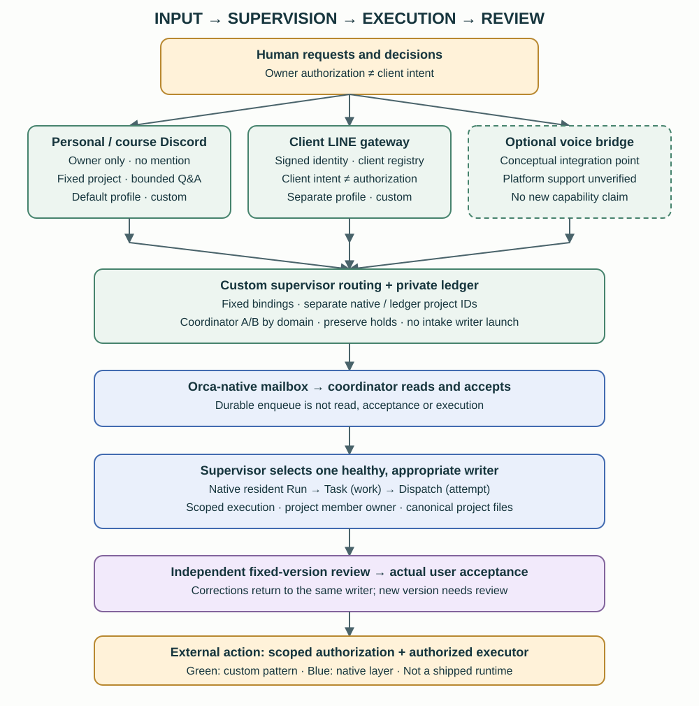
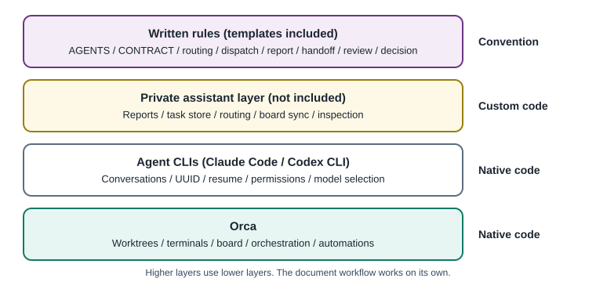

# 2. Architecture: from request to accepted result

[English](../en/02-architecture.md) | [繁體中文](../zh-TW/02-architecture.md) | [Home](../../README.md)



## 2.1 Six roles

```text
User → coordinators A/B → domain → one writer → independent reviewer → acceptance / external action
```

| Role | Appointed by | Responsibility | Outside the role |
|---|---|---|---|
| User | The human | Requests, decisions, acceptance, authorization | Supervising every line of work |
| Primary coordinator | Routing table | Intake, assignment, blockers, evidence | Most implementation, except §4.3 |
| Reviewing coordinator | The other coordinator | Independent review of important deliveries | Claiming user acceptance |
| Domain | Routing configuration | Choose supervisor and reviewer | Choosing the actual writer |
| Writer | Domain supervisor | Produce within scope and attach self-test evidence | External actions or more agents unless specifically authorized |
| Independent reviewer | Separate from writer | Review a fixed version; report severity and evidence | Editing reviewed files |

## 2.2 Why two coordinators?

- **Independent checks**: different agents can catch errors missed by self-review. This is a design rationale, not a guarantee that any model pair will outperform another.
- **Shared workload**: each coordinator supervises its domains, keeping context manageable.
- **Continuity**: when one coordinator is unavailable, the domain reviewer can act as supervisor. The reference router computes the acting coordinator from `available` and `unavailable_until` [Custom]. Actually taking over is still [Convention].

## 2.3 Keep three layers separate

1. **Execution**: project sessions maintain their own canonical files, such as project `STATUS.md` and task lists.
2. **Supervision**: a coordinator prioritizes, dispatches and follows up.
3. **Review**: the other coordinator checks important deliveries.

Routing changes supervision and review. It does not automatically replace the writer or move a project's canonical files. The central board is a projection of project state [Convention].

## 2.4 Human authorization

These actions require applicable, explicit authorization from the user [Convention]: sending messages externally; submitting forms or applications; payments and new spending; publishing or deploying; creating accounts or changing permissions; and irreversible deletion.

Before asking again, locate the original authorization and check whether this action remains within its scope, recipient, timing and version. If so, proceed. **Existing authorization persists; do not repeatedly ask for the same authorized action.** If a necessary part is missing or unclear, prepare a concrete, reviewable result first and ask only for that missing decision.

Orca's public artifact publishing is separately disabled by default and can be enabled only by a human in desktop settings [Native, installed CLI guide]. That gate covers Orca artifacts, not every external tool an agent can use.

## 2.5 Native, custom and documented layers



| Layer | Components | Shipped here? |
|---|---|---|
| Orca | Worktrees/folders, terminals, board columns/comments, orchestration, automations | No; install Orca separately |
| Agent CLI | Sessions, resume, permission mode, model selection | No |
| Private assistant layer | Contract acknowledgement, station reports, task database, router, board sync, inspections | No; interfaces are explained |
| Written conventions | Agent rules, dispatch, review and handoff formats | Yes, in `templates/` |
| Adoption utilities | Safe template copying and handbook build/check scripts | Yes; they do not run your agents |

Start with the document workflow. Add private automation only when it solves a concrete tracking problem.
