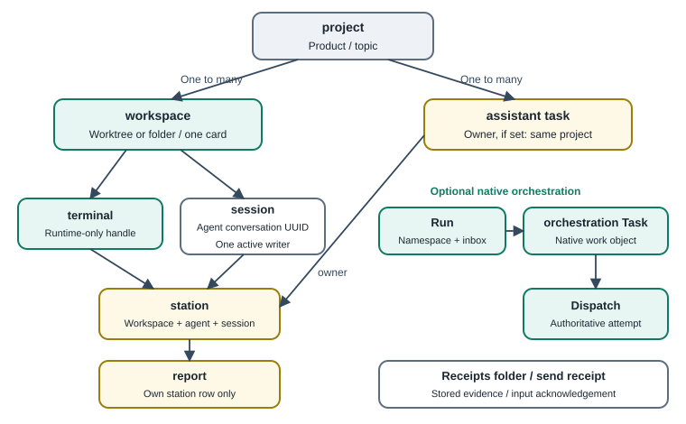

# 3. Concepts, identities and bindings

[English](../en/03-concepts.md) | [繁體中文](../zh-TW/03-concepts.md) | [Home](../../README.md)

Do not treat a workspace as a reporter, or an assistant task as an Orca orchestration Task.

## 3.1 Definitions

| Term | Meaning | Identifier / source |
|---|---|---|
| Project | Logical product, course or research topic, possibly with multiple workspaces | Orca has project objects; reference assistant IDs such as `P-EXAMPLE-WEB-A` are separate. Mapping is [Unknown] |
| Workspace | Orca's tracked worktree or folder, terminals, browser tabs and board card | `id:<repoId>::<path>`, `path:<path>`, `active` [Native] |
| Terminal | Managed pane containing a shell or agent TUI | Runtime handle `term_EXAMPLE01` [Native] |
| Session | An agent CLI conversation, resumable using its original UUID | `SESSION-EXAMPLE-A` [Agent-native] |
| Station | Reporter identity: workspace + provider + session (or Orca pane) | `S-EXAMPLE-A` [Custom] |
| Report | One station's state, summary, next action, evidence and blockers | One row per station with revision [Custom] |
| Assistant task | Cross-turn to-do with priority, deadline, evidence and reviewer | `T-EXAMPLE0001` [Custom] |
| Orchestration Task | Orca's unit of supervised work, with possible dependencies | Returned by task creation [Native] |
| Run | Durable orchestration namespace and coordinator inbox | `run_EXAMPLE` [Native] |
| Dispatch | One authoritative attempt at an orchestration Task | Returned by worker start/dispatch [Native] |
| Dispatching work | The act of assigning work; need not create a Dispatch object | General workflow term [Convention] |
| Send receipt | Result of terminal input, including acceptance and submission stages | JSON with `input_accepted`, `turn_started` [Native] |
| Receipts directory | Local evidence, test output and handoff records | `HUB_ROOT/receipts/<topic>-<date>/` [Convention] |
| Domain | Routing category choosing supervisor and reviewer | For example `web_sites`, `research` [Custom] |

## 3.2 Two kinds of task, two kinds of receipt

An **assistant task** is the user's tracking record. An **orchestration Task** tracks a supervised Orca worker attempt. Native `worker-start` manages Dispatch authority, heartbeat and `worker_done` obligations.

The reference frequently assigns work through `terminal send` or an orchestration message, then tracks it in the custom task list. It does not establish a native Task for every request. Native supervised operation is available; universal adoption in that deployment is [Unknown].

`accepted: true` means input was accepted, not that a turn began. Look for `turn_started` or use `--wait-submit` [Native]. The local `receipts/` directory is simply a place to store evidence [Convention].

## 3.3 Binding rules

1. One workspace normally appears as one board card, even with multiple sessions [Native observation; version-dependent]. Per-agent dashboard availability is [Unknown].
2. One session UUID has at most one active writer. Never resume it in two terminals [Convention].
3. Each station reports only its own row [Custom]. Two sessions in a project remain separate reporters.
4. Project, workspace, station and task IDs are not interchangeable. If supplied, a task owner must belong to that project [Custom]. The owner field can be omitted; requiring every task to have an owner is [Convention].
5. Terminal handles can become stale after restart. Re-list, use the replacement, and never send to both [Native + Convention].
6. Station checks establish attribution, **not secure authentication**. Workspace/provider matching reduces mistakes, but another sufficiently privileged local process can supply someone else's session or station ID [Custom limitation].

## 3.4 Canonical files and projections

| | Canonical source | Coordinator projection |
|---|---|---|
| Writer | Project owner/session | Coordinator or sync program |
| Example | `PROJECT_ROOT/STATUS.md` | Central board, daily summary, card comment |
| Conflict | Source wins | Regenerate from source |
| Manual editing | Follow project rules | Avoid editing generated files |

The reference collector reads project sources without modifying their status. It retains source modification times, does not call scan time “verified at,” and reports unreadable sources as unknown rather than complete [Custom + Convention].

## 3.5 Private CLI interface reference (not included)

This is a conceptual interface summary, **not an installation guide for shipped software**.

| Command | Purpose | Reference enforcement [Custom] |
|---|---|---|
| `brief` | Get station, current contract hash, report revision and project tasks | Reject unregistered workspaces; do not invent identities |
| `join` | Self-report reading the contract | Exact current SHA-256 required |
| `report` | Update own station | Current contract joined; summary/next; evidence for review/done; blocker for blocked; matching revision; identical reports no-op; acceptance stays unverified |
| `task-add` | Register tracked work | Deduplicate same key; validate owner if supplied |
| `task-update` | Change state | Matching revision; evidence for review/done; done also needs review note and `coordinator_review` or `user_confirmed` |
| `task-list`, `overview`, `doctor` | Read state or health | Read-only |
| `sync` | Collect, rebuild projections, update board | Does not launch agents or dispatch. `--ensure-rules` may back up and update rule-entry files in registered workspaces |

The separate reference router has `show`, `validate`, `audit`, `triage`, `who`, `assign`, `unassign`, `set-domain`, `availability` and `set-project`. Writes lock, back up, increment version, append a changelog, validate, and optionally check `--expect-version` [Custom]. Board synchronization defaults to a dry run; `--apply` makes native card changes.
