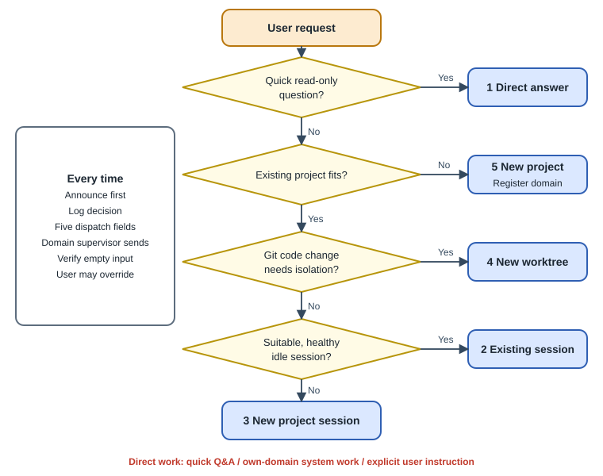
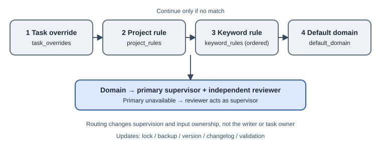

# 4. Five dispatch decisions and routing

[English](../en/04-dispatch-routing.md) | [繁體中文](../zh-TW/04-dispatch-routing.md) | [Home](../../README.md)

## 4.1 Announce before acting

For each request, declare the decision on the first line [Convention]:

```text
Decision: <1-5> <method> | <target> | <one-sentence reason>
Decision: 2 Existing session | Website A writer | Owns this copy change and is healthy and idle
```

The user may change the decision, for example “use option 4 instead.” The announcement makes an incorrect assignment visible before work starts.



## 4.2 Five methods

| Option | Method | When | Executor |
|---|---|---|---|
| 1 / ① | Direct answer | Read-only question taking a few minutes; no project edits | Coordinator |
| 2 / ② | Existing session | Appropriate project session is healthy and idle | That session, via its domain supervisor |
| 3 / ③ | New session in project | No suitable session, existing session busy, or independent parallel work | New project session |
| 4 / ④ | New worktree | Git code changes need isolation | Agent in a new worktree |
| 5 / ⑤ | New project | No existing project fits | New project, registered in routing |

Healthy and idle means not working, not waiting on a user decision, not fallen back to a shell and not reporting reconnection failure. **Read the input field before sending.** Grey suggestions are not drafts; actual user text must be preserved [Convention].

### Reference suggestion tool

The private `triage` tool combines keywords, workspace names, routing and terminal state to suggest an option and a message skeleton. It reads native workspace/terminal lists and inspects terminal status [Custom]. This is a heuristic suggestion, not a mandatory classification or proof of agent health.

## 4.3 Three reasons a coordinator may do the work itself

1. A quick read-only answer under option 1.
2. System work in a domain that coordinator supervises.
3. The user explicitly says **“do this yourself.”**

Otherwise the domain supervisor delegates [Convention]. The reference logs decisions as JSONL and inspections count action requests handled directly [Custom]. Logging every request remains a convention; missing records make statistics incomplete.

## 4.4 Routing precedence

The reference router uses first match wins [Custom]:

1. Task-specific override.
2. Project-to-domain mapping, excluding the coordinator's general intake project.
3. Ordered title keyword rules.
4. Default intake/triage domain.



A domain has a `primary`, a different `reviewer`, and a readable `label`. Coordinator availability controls temporary failover; expiry is evaluated when queried. `max_working` and `balance_warn_ratio` produce audit warnings, **not hard scheduling limits** [Custom].

### 4.4.1 Reference assignment: ten domains

This anonymized map reflects the source deployment at the edition date. It is an adjustable organizational choice based on workload and habits, **not a model-quality ranking**. The starter routing template deliberately uses only four domains.

| # | Domain | Primary | Reviewer |
|---|---|---|---|
| 1 | Portfolio review, prioritization, unclassified intake | B (Codex) | A (Claude) |
| 2 | Admissions, scholarships, grants, internships | B | A |
| 3 | Coursework, assignments, examinations | B | A |
| 4 | Personal administration, insurance, accounts, documents | B | A |
| 5 | Startup planning documents and funding applications | B | A |
| 6 | Community and event applications | B | A |
| 7 | Voice and AI product development | A | B |
| 8 | Websites, frontends and collaborative editing | A | B |
| 9 | Orca and assistant operations, session recovery | A | B |
| 10 | AI model, tool and dispatch research | A | B |

Each row has one supervisor and another reviewer. During unavailability, the reviewer acts as supervisor. Change source routing through its supported update commands, not by editing query output [Convention].

## 4.5 Input and recovery ownership

| Action | Permitted operator [Convention] |
|---|---|
| Read any terminal | Either coordinator |
| Send project instructions | Domain supervisor or user; otherwise change routing first |
| Recover disconnected sessions | Operations-domain supervisor, across domains |
| Interrupt the other coordinator | Do not do it |
| Submit another terminal's pending draft | Do not do it |
| Change global configuration or restart Orca | Propose to the user; not authorized by this role |

Orca does not generally enforce the domain rule on `terminal send`. Centralizing recovery avoids two coordinators resuming the same UUID simultaneously.

## 4.6 Five required parts of a dispatch

Use `templates/en/dispatch-message.md` [Convention]:

1. Original user request and observable acceptance criteria.
2. Read/write boundaries and forbidden external actions.
3. Permission to open terminals or agents, concurrency and spending limits.
4. Required self-test evidence.
5. Report only the executor's own station after delivery.

In the 2026-10 reference, options 2-5 deliver this message as the `--spec` of a native supervised worker, and part 5 also requires `worker_done` with `--report-path` (and `--files-modified` when files changed) [Convention; chapter 14]. Only the domain supervisor starts that worker.

Review work uses the separate review templates in chapter 6.

## 4.7 Record the decision

Conceptual private CLI example (not shipped):

```text
<routing-CLI> triage --text "<request>" --record --decision <1-5> --target <handle-or-path> --by <A-or-B>
```

Without that tool, append time, request summary, decision, target and deciding coordinator to private `receipts/dispatch-log.md`. Make it possible to audit later. The reference writes JSON lines; its daily read-only inspection counts decisions and names action requests a coordinator handled itself [Custom].

## 4.8 Change assignments as data

A user may reassign a project or mark a coordinator unavailable. In the reference deployment, routing update commands validate and record the change. Reassigning a domain does not change the shared contract, so it does not require every station to acknowledge a new contract hash.
