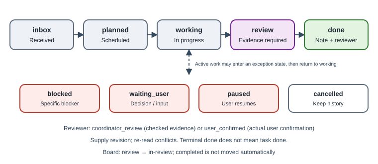

# 6. Lifecycle, evidence and acceptance

[English](../en/06-lifecycle-review.md) | [繁體中文](../zh-TW/06-lifecycle-review.md) | [Home](../../README.md)

## 6.1 States



```text
inbox → planned → working → review → done
```

| State | Meaning | Requirement |
|---|---|---|
| `inbox` | Received, not scheduled | Title and actionable next step [Custom] |
| `planned` | Scheduled, not started | Planned next action |
| `working` | Writer is working | Known ownership |
| `blocked` | Cannot progress | Specific blocker on station report [Custom] |
| `waiting_user` | Needs user input or decision | State exactly what is missing |
| `review` | Delivered, awaiting verification | Evidence [Custom] |
| `done` | Completion accepted on evidence | Evidence, review note, reviewer [Custom] |
| `paused` | User requested pause | Do not resume merely because a deadline approaches [Convention] |
| `cancelled` | Cancelled | Preserve history |

Updates supply the last read revision. A mismatch means another writer changed the record: re-read and decide, rather than blindly retrying [Custom optimistic locking].

## 6.2 Information to record

Not every item is a field on the task row. The reference distributes them across tasks, reports, decisions and board comments.

| Information | Meaning and storage |
|---|---|
| Owner | Station on task; validated if provided, optional in code, required by convention |
| Next | A concrete executable action, not “continue” |
| Priority | 1, 2 or 3 |
| Due / due-kind | `target`, `confirmed_deadline`, `source_unverified`; preserve a date-only deadline as a local calendar date, do not invent a time |
| Source | Original request, date, document or authority |
| Evidence | Deliverable or proof paths on task |
| Blocker | Specific impediment on station report |
| Decision | Decision record, referenced in task next action |
| Checkpoint | Concise workspace card comment |

Register work that needs cross-turn tracking, not every sentence. The reference deduplicates repeated task keys [Custom].

## 6.3 What counts as evidence?

The reference CLI rejects `review` and `done` with an empty evidence field [Custom]. If a writer says “finished” without evidence, leave the task `working` and request it. A nonempty field is a syntactic check, **not proof that the evidence is meaningful**.

Useful evidence includes test commands and results, file paths plus SHA-256, screenshots or page renders with review coverage, write-then-read-back results, and receipts for already authorized external actions.

An agent's assertion is not evidence. A terminal displaying “done” only means a turn ended. Keep these events distinct: draft prepared, sent, delivery receipt received, and formally accepted.

## 6.4 Review versus done

| | Review | Done |
|---|---|---|
| Meaning | Writer delivered evidence; verification pending | A reviewer checked and accepted the evidence |
| Required | Evidence | Evidence + review note + reviewer |
| Reviewer value | Pending | `coordinator_review` or `user_confirmed` |

`coordinator_review` records actual coordinator verification. It does not mean user acceptance. Record `user_confirmed` only after a real user confirmation, citing when and how. The private CLI checks the field, not the truth of that claim [Custom limitation].

Station reports are self-reports. Even `done` station reports are labeled unverified in the reference deployment [Custom].

## 6.5 Bind review to a version

Include the path and SHA-256 or Git commit in a review request. Repeat it in the report. If the deliverable changes, review the new version, at least its changes. The delivered hash must match the reviewed hash [Convention].

The reference does **not** enforce artifact-hash binding. Task revisions and contract hashes are enforced, but artifact review binding relies on the template and reviewer. An implementation could require `sha256=...` in a structured review record and compare it before delivery.

## 6.6 Review dispatch

Use the review request/report templates [Convention]:

1. Read-only; no changes to reviewed material.
2. Each finding includes location, high/medium/low severity, evidence and recommendation.
3. If there are no findings, say so; do not invent issues to meet a quota.
4. The supervisor verifies a sample of findings before presenting them to the user.

Important submissions and releases should receive independent review. The reference audit only flags missing cross-review for **highest-priority application tasks in `waiting_user` or `review`** [Custom]. It is not a universal publication gate; website reviews and other categories rely on convention.

## 6.7 Coordinator handoff

1. Put evidence and notes in a private, topic-specific receipts directory.
2. Record original request, completed/incomplete work, paths/hashes, risks and next action.
3. Update the task with evidence and the precise review request.
4. The recipient reads the handoff and reports from its own station before claiming takeover.
5. `orchestration send` success establishes enqueue, not read or acceptance. A terminal-only mailbox may cease to be reachable when that terminal closes; prefer stable Run or Dispatch addresses [Native].

## 6.8 Completion signals

| Signal | Establishes | Does not establish |
|---|---|---|
| Terminal done/idle | Agent turn ended | Deliverable complete |
| Station report done | Owner claims completion | Independent acceptance |
| Task review | Evidence available | Review passed |
| Task done + coordinator_review | Coordinator checked evidence | User accepted |
| Task done + user_confirmed | User accepted | A separate external action happened |
| Board completed | Human or explicitly authorized move | Automatic verification; reference sync never moves cards into completed |

## 6.9 Sounding finished is worse than being wrong

A wrong result that is labeled honestly gets caught in review. A result that *sounds* finished without evidence skips review and reaches the user as fact. The reference therefore treats premature completion language as the more dangerous failure [Convention]:

1. **No evidence, no done.** `review` and `done` need a readable path and result; “should work” or “looks fine” is not evidence.
2. **Say the weakest true thing.** Use “prepared”, “sent”, “receipt received” and “accepted” only for what actually happened (§6.3). A draft is not a submission; enqueue is not read; `worker_done` is not acceptance.
3. **Missing sources show unknown.** If a source is unreadable, a station has not reported, a report is stale or Orca is unreachable, the summary says unknown or stale, never complete (§3.4).
4. **Report what was not checked.** A delivery lists skipped steps and untested environments next to the evidence.
5. **Never invent confirmation.** `user_confirmed` requires the user's actual words, time and channel.

Client-facing replies apply the same rule through an output guard (§15.5).
