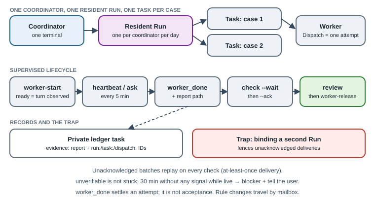

# 14. Native orchestration: one resident Run per coordinator

[English](../en/14-native-orchestration.md) | [繁體中文](../zh-TW/14-native-orchestration.md) | [Home](../../README.md)

Since the 2026-10 edition, the reference deployment dispatches every writer as a **supervised Orca worker** instead of typing a dispatch into a terminal and hoping it is read. This chapter explains that lifecycle, the one trap that matters most (Run fencing), and how the private ledger links to native IDs.

Native facts below were checked against Orca CLI **1.4.220** help and the MIT-licensed Orca source at the matching tag. Source paths are relative to the Orca repository and are cited so you can verify them; behavior may change in later versions. Rules about *when* to use each verb are [Convention].



## 14.1 Three layers, two kinds of record

| Layer | Owns | Example identifiers |
|---|---|---|
| Private ledger (custom) | What the user asked for, priority, deadline, reviewer, acceptance | `T-EXAMPLE0001` |
| Orca Run / Task / Dispatch (native) | Who is executing it now, liveness, messages, the authoritative attempt | `run_xxx`, `task_xxx`, `ctx_xxx` |
| Project files (canonical) | The deliverable and the project's own status | `PROJECT_ROOT/STATUS.md` |

The ledger stays the user's single to-do list. A native Task represents work; a Dispatch is one authoritative attempt at that work. They are complementary, not duplicates, and neither replaces project-owned status files [Convention].

## 14.2 One resident Run per coordinator

A coordinator terminal is bound to **at most one Run at a time** [Native]. Binding another Run (`run-create` or `run-use`) increments a consumer generation and marks the previous Run's unacknowledged deliveries as `fenced` (`src/main/runtime/orchestration/db/runs/run-binding.ts`, `db/messages/role-mailbox-delivery.ts`). `check` reads the currently bound Run by default (`messaging/check-run.ts`).

The earlier “one Run per case” habit therefore broke as soon as a coordinator supervised several cases: while waiting on Run B, Run A's `worker_done` was invisible, and switching back fenced B's pending batch. The reference changed the rule [Convention]:

1. Each coordinator keeps **one resident Run**, retained across dates while work remains active.
2. Each case is a **Task** inside that Run, created by `worker-start --task-title "<case>"` (add `--parent` for sub-steps).
3. A date change does not authorize switching Runs. Check every active Dispatch with `worker-list`, preserve its reachable mailbox, process and acknowledge old deliveries, and settle work with terminal cleanup decisions before explicitly switching. Unknown liveness does not mean settled.
4. When writing to the other coordinator, address **their** resident Run (`--run <their run> --to <their handle>`).

## 14.3 The supervised lifecycle

Replace placeholders; read your installed `orca skills get orchestration` first, because it ships with your binary and is the authority for your version.

```text
orca orchestration worker-start --run <run> --from <coordinator-handle> \
  --worktree <current|path:...|new-child> --agent <claude|codex> \
  --task-title "<case>" --spec "<full dispatch message or its path>" --json
orca orchestration check --run <run> --terminal <coordinator-handle> --wait \
  --types worker_done,escalation,question --timeout-ms <ms> --json
# Process every message, review completion evidence and decide terminal ownership; this example releases it.
orca orchestration worker-release --dispatch <dispatchId>
orca orchestration check --run <run> --terminal <coordinator-handle> --ack <deliveryId> --json
orca orchestration worker-read --dispatch <dispatchId>
```

| Step | What it proves | Source |
|---|---|---|
| `worker-start` returns `state: ready` | Orca observed the worker's turn actually start; otherwise it reports `start_unknown`, never an optimistic success | `rpc/methods/orchestration/worker/worker-start-readiness-settlement.ts` [Native] |
| Non-ready result | Read `failedStage`; do not bypass with an invisible sub-agent | Help text [Native]; bypass ban is [Convention] |
| Worker heartbeats every 5 minutes | `last_heartbeat_at` is updated on the matching Dispatch only | `preamble.ts`, `dispatch-completion.ts` [Native] |
| `ask` | Durable question thread; the worker blocks until the coordinator replies | `messaging/ask-methods.ts` [Native] |
| `worker_done` once, with task and dispatch IDs | Settles that Dispatch; a late message from an older attempt cannot settle a retry | `worker-report-settlement.ts`, `lifecycle-reconciliation.ts` [Native] |
| `worker-release` after review | Archives the transcript, then closes the Orca-created terminal | `db/worker-terminal/worker-terminal-archive.ts` [Native] |

The reference requires every worker to send `worker_done` with `--report-path <receipts/.../report.md>`, plus `--files-modified` when files changed [Convention]. `worker_done` settles the attempt; it is **not** acceptance (§6.8).

## 14.4 At-least-once delivery: always acknowledge

Each mailbox has at most one outstanding delivery batch. Until you acknowledge it, every `check` **replays the same batch** (`replayed: true`) [Native, `role-mailbox-delivery.ts`]. This means a crash never loses mail, and it also means a coordinator that forgets `--ack` keeps re-reading old messages. Process the batch, record what you did, then acknowledge.

A successful `send` proves durable enqueue, not that anyone read it (§6.7). A receipt is never a substitute for the recipient's reply.

## 14.5 Liveness and the stale-heartbeat checklist

`worker-list` reports `liveness ∈ live | unverifiable | exited`, an `attention` list and a suggested `nextAction` with ready-to-run arguments (`src/shared/orchestration-fleet-projection.ts`) [Native]. “Unreachable” is not “dead”: only positive evidence from the owning host makes a worker `exited`.

The retired automatic coordinator loop used to warn about stale heartbeats; in the current model no code raises that warning (`coordinator.ts` is the only caller) [Native gap]. The reference fills the gap with a written checklist [Convention]:

1. `liveness: unverifiable` → do not act; never treat it as stuck.
2. `attention` shows input or guidance → answer the pending `ask` first.
3. No `ready`, `turn_started`, heartbeat, `worker_done` or question for **30 minutes** while `live` → record a blocker on the ledger task and notify the user.
4. Otherwise follow `nextAction`; never stop, abandon or retry on silence alone.

## 14.6 Waiting for the user: gate or `waiting_user`

`gate-create` blocks a native Task immediately (`db/decision-gates/decision-gate-store.ts`) [Native]. The ledger's `waiting_user` is the list the user actually reads [Custom]. To avoid two drifting records, use a gate only when a **live worker** is blocked on the decision, cite `gate:<id>` in the ledger task's next action, and update both when the gate resolves [Convention]. Login, consent and account steps are always the user's; workers must not try to work around them.

## 14.7 Rule synchronization through the mailbox

Running sessions do not reread their rule files. The reference no longer types “please reread the rules” into the other coordinator's terminal [Convention since 2026-10]:

```text
orca orchestration send --run <other coordinator's run> --to <other handle> \
  --type status --subject "Reread rules" --body "<summary, file paths, old/new hashes>"
```

When the recipient's pane is idle, Orca types a one-line pointer (“You have N orchestration messages…”); it does not interrupt a busy pane and does not repeat while a batch is outstanding (`mailbox-pointer-delivery.ts`, `formatter.ts`) [Native]. The pointer targets `run:` and `dispatch:` mailboxes, so the recipient should hold a bound resident Run; behavior without one is [Unknown] — smoke-test it once. Synchronization is complete only when the recipient acknowledges and replies “reread, version X” [Convention].

## 14.8 Link the ledger to native IDs

When a coordinator moves a ledger task to `review` or `done`, its evidence cites the report path **and** `run:<id> task:<id> dispatch:<id>` [Convention]. An auditor can then open the archived transcript with `worker-read --dispatch <id>` instead of collecting screenshots. Nothing enforces this link automatically; the ledger only checks that evidence is nonempty (§6.3).

## 14.9 Per-dispatch model effort (option)

`worker-start` accepts `--model` and `--effort` (effort requires model) and records them on the Dispatch [Native]. Selecting effort per dispatch avoids changing global defaults for one critical task. The reference documented this as a recommendation; it is **not yet an adopted rule** there.

## 14.10 Design lessons worth copying

- **Rules beside examples.** Orca's worker preamble puts each rule as a comment directly above the command it governs, in plain language rather than capitals, because readers anchor on examples (`preamble.ts`). Write dispatches the same way.
- **Positive evidence or “unknown”.** `ready` requires an observed turn start; `exited` requires proof from the owner. Never upgrade silence to success or failure.
- **Attempt-scoped identity.** Every message carries the Dispatch ID so old attempts cannot settle new ones.
- **Guides ship with the binary.** `orca skills get` returns the guide for your installed version; quote it instead of copying stale notes.

## 14.11 Dedicated-channel notice is not dispatch

The custom intake in [chapter 16](16-dedicated-project-intake.md) creates a private project task and sends a native mailbox notice; it neither starts a worker nor automatically binds native execution IDs. The coordinator accepts scope, checks holds and permissions, and selects a writer before entering this lifecycle. Reverify recipient bindings after session replacement; successful enqueue still does not mean read.
