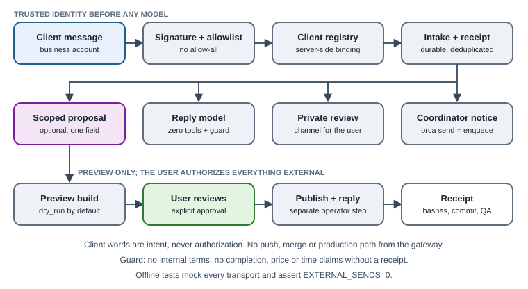

# 15. Client message intake gateway

[English](../en/15-client-intake-gateway.md) | [繁體中文](../zh-TW/15-client-intake-gateway.md) | [Home](../../README.md)

The reference deployment also accepts change requests from website clients through a messaging-app business account (for example a LINE Official Account). This chapter describes the **architecture and safety boundaries** of that intake gateway. The implementation is private and **not included**; clients, sites and identifiers below are fictional (“Client A”, `example.invalid`).

The pattern fits any self-hosted agent gateway (the reference uses a Hermes-style gateway with separate profiles). The key idea: **the model that talks to clients holds no tools, and nothing it says is authority.**



## 15.1 Flow

```text
Client message → business account webhook → gateway adapter
  → signature check → allowlist → server-side client registry
  → durable intake record + ledger task (receipt)
  → short reply from a tool-less model, filtered by an output guard
  → private review channel for the user + Orca notice to the supervising coordinator
  → (optional) one scoped proposal tool → preview build only
  → user approves → separate operator workflow publishes and replies
```

| Component | Can do | Cannot do |
|---|---|---|
| Messaging adapter | Verify signature, enforce allowlist, map sender to a registered client | Accept a client, repository, task or permission named in message text |
| Reply model | Write a short natural reply | Use tools, run commands, dispatch agents, read files, remember across clients |
| Proposal tool (optional) | Propose a value for one enumerated content field | Push, merge, deploy to production, change code, design or other clients' sites |
| Review channel | Show the user a summary, status and next step | Post full client text, mention people, fall back to a public channel |
| Coordinator | Prepare work, previews, drafts and evidence | Send to the client, quote, buy or publish without the user's explicit authorization |

## 15.2 Identity: allowlist, never allow-all

Trust comes from the platform signature, an explicit **allowlist** of sender IDs and a server-side registry binding each sender to one client and one site [Custom]. Allow-all is not used: an unknown sender is not a client, and new clients are added by the user after checking the record. Clients cannot select a client, repository, branch, task or permission by writing it in a message; foreign selectors, foreign URLs and common injection phrases are rejected. Administrative slash commands start disabled until the user's own ID is configured.

Memory is disabled in the client-facing profile because it would be shared across clients. Client data lives only in the private registry and each client's repository.

## 15.3 Zero tools, one scoped proposal

The general gateway agent has **no tools** [Custom]. Client text is passed as user-role data only. The only capability is a bounded, single-call completion that may emit exactly one `propose_site_edit(path, value)`:

- `path` must be a leaf listed in the site's `editable.schema.json`, with type, length, link and image rules. Links must be HTTPS on an exact allowed hostname; images must come from an approved local gallery.
- The server re-validates in an ephemeral, detached worktree, writes only the content file, builds, and runs fixed local QA (exact value, rendered text, two viewport widths, console errors). External browser requests are blocked during QA.
- Only a dedicated `preview-*` ref is updated, with compare-and-swap. No push, merge, main checkout or production command exists in that code path.
- The default mode is **`dry_run`**: no preview URL, clearly stated as not deployed. A real preview needs a separately enabled binding and a credential the user created personally.
- Receipts record before/after hashes, identity, commit, QA and deployment result. Model prose claiming success is never accepted; only a read-back receipt is.

Adding or removing sections, design changes and code go to normal intake for a human-supervised writer.

## 15.4 Human review and notifications

Every routed request writes a durable outbox entry before sending [Custom]:

- **Private review channel** (the reference uses one private Discord channel per client): summary, IDs, status and next step only; mentions disabled; bot, owner and channel permissions checked before sending; no public or debug fallback. Retries use a stable nonce and read back earlier attempts so a lost receipt does not cause a duplicate post.
- **Supervising coordinator**: `orca orchestration send --type status` to a fixed handle. Its receipt is durable enqueue, **not** proof the coordinator read or accepted the request (§14.4). If Orca is unavailable the notice stays pending; it is never resent blindly without a mutation ID.

A client saying “approved”, “publish it” or “confirm preview” is recorded as **client intent**, never as production authorization. Production publishing remains a separate step approved by the user.

## 15.5 Reply guard: do not sound finished

A final guard covers every outgoing text path [Custom]. It removes internal terms (ticket numbers, “queued”, “supervisor”, the user's name) and rewrites unsupported claims. The reply may say “we'll adjust it and let you confirm” only when this request has a matching intake receipt; without one it may not claim anything was arranged, done or scheduled. Price, availability and delivery-time promises are blocked unless a verified, human-sent quote exists. The guard is defense in depth and can miss phrasing; the real boundary is fixed identity, zero tools and no executor.

## 15.6 External actions stay with the user

| Action | Who | Note |
|---|---|---|
| Reply text in the conversation | Gateway, within the guard | Natural acknowledgement only |
| Quotes, prices, contract terms | The user, personally | Coordinator may prepare a draft with a read-only helper |
| Domain or service purchase, payment details | The user, personally | Agents never enter card numbers or buy |
| Production deploy, custom domain binding | Coordinator **after** explicit user approval for that site and version | Verify and keep a receipt |
| New platform accounts, tokens | The user | Tokens go to the OS keychain, never chat, files or logs (§5.7) |

## 15.7 Test offline: external sends must be zero

The reference test runner strips inherited credentials, blocks sockets, DNS and unexpected subprocesses, and mocks the model, messaging platform, task API, review channel and Orca transport [Custom]. It uses synthetic client configs; a real handle or token fails before transport. The suite asserts **`EXTERNAL_SENDS=0`**, including a deliberate egress attempt that must be blocked and counted. Browser/build checks run against a loopback server that is closed afterward. Passing offline tests says nothing about production delivery, which was not exercised.

Reload the gateway only when it is idle (no active agents or replies, no pending messages), keep unrelated gateways and tunnels running, and compare the loaded module, adapter, persona and config hashes with the files on disk [Custom].

## 15.8 Adoption checklist

- [ ] Allowlist and server-side registry; no allow-all; no client-selectable identity.
- [ ] Client-facing model has zero tools and no shared memory.
- [ ] Any edit capability is a single schema-bound proposal that only produces a preview, `dry_run` by default.
- [ ] Durable outbox, private review channel, no public fallback.
- [ ] Output guard blocks internal terms and unreceipted completion, price or time claims.
- [ ] Every external send, quote, purchase and production deploy has explicit user authorization.
- [ ] Offline tests prove external sends are zero before any reload.
