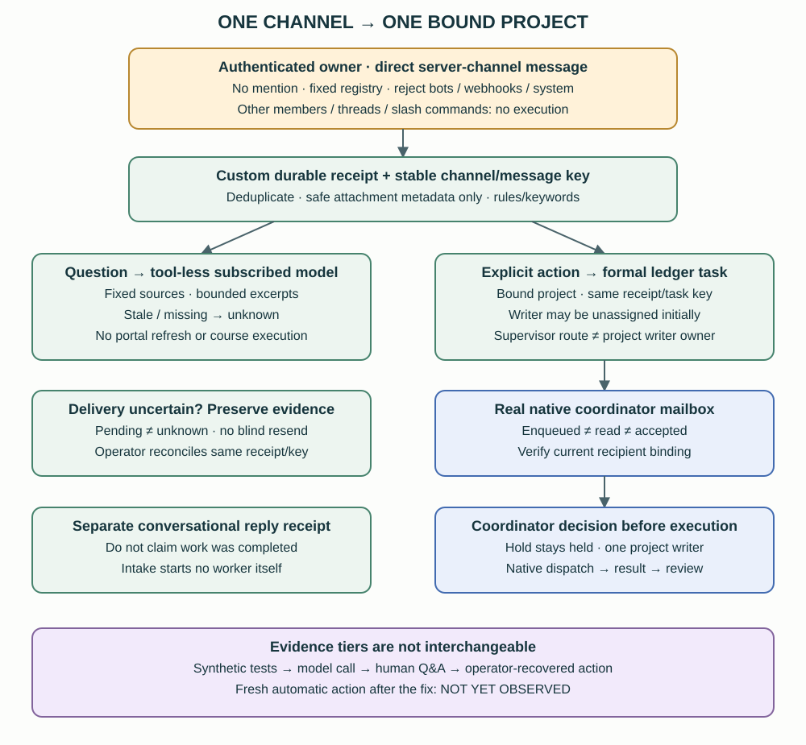

# 16. Dedicated Discord course and project intake

[English](../en/16-dedicated-project-intake.md) | [繁體中文](../zh-TW/16-dedicated-project-intake.md) | [Home](../../README.md)

A dedicated channel gives the authenticated owner a fixed place to ask about one course or project, without mentioning the bot. This **private reference architecture is not a shipped daemon**. This repository supplies explanations and illustrative templates, not the gateway, registry, credentials or private sources. Client LINE intake remains a separate profile and authority model ([chapter 15](15-client-intake-gateway.md)).

## 16.1 Fixed binding and authenticated owner

The operator-owned registry binds each allowed server/channel to a canonical project, approved workspace and fixed source list [Custom]. It records the **native Orca project ID and private ledger project ID separately**. This explicit mapping applies to registered channels; it is not a universal mapping of every project in the system.

The gateway verifies platform-derived server, channel and owner identity. It rejects other members, bots, webhooks and system messages. Knowing the channel or typing an owner ID does not confer authority. Recognized dedicated channels fail closed on malformed events or hook failure rather than falling through to a general agent. Only direct messages **in the registered server channel** are supported here; this does not mean Discord DMs. Threads and slash commands are outside this extension.

No mention is needed, but owner-only authorization still applies. Message text cannot change the registry, source paths, project, supervisor or permissions. A cross-project request is directed to the correct channel; the extension does not dynamically reroute it or provide all-project semantic routing. Operator changes require separate verification of the binding.

## 16.2 Bounded Q&A versus explicit action intent

For a question, the gateway assembles bounded excerpts from fixed local sources in the bound project and calls the configured subscribed model with **no tools** [Custom]. Sources and messages are untrusted data. The model cannot browse, edit, dispatch or execute. Replies identify their sources; missing, unreadable or stale sources mean current status is **unknown**. General conceptual explanations must be labeled as general knowledge. Subscription use does not mean data stays local.

There is no automatic course-portal login, refresh or arbitrary URL/file access. A fresh model reply does not make an old source current. Attachments supply only sanitized metadata such as name, size and source reference: the extension does not read or execute their contents or send them to the model. The native adapter may cache attachments **before** the hook, so this is not a claim that the whole platform never downloads them.

Action detection currently uses simple rules/keywords, not reliable semantic classification. Use explicit wording such as “Create a task to prepare a summary for this project; do not execute yet.” A missed action must not be presented as completed work by the Q&A model. The coordinator reads the actual request, including holds, before deciding what to execute.

## 16.3 From one receipt to a real coordinator mailbox

For recognized action intent [Custom unless labeled otherwise]:

1. Persist a message receipt with a stable channel/message deduplication key. Repeated delivery of the same message must not create another request.
2. Create a formal task in the **bound private ledger project**, with a stable task key and a link to the receipt. A task-creation failure leaves intake pending; it does not mean a writer started.
3. Notify the configured coordinator through the **real native Orca mailbox** [Native transport]. Keep its send receipt alongside the intake receipt. Reverify the current coordinator terminal and mailbox binding when its session is replaced; a connected handle alone does not establish the correct recipient role.
4. The coordinator reads and accepts or clarifies the request, preserves any hold, and selects an appropriate healthy sole writer. Only then does supervised native execution create/use its Run, Task and Dispatch ([chapter 14](14-native-orchestration.md)). Intake itself never launches writers or executes coursework.

The supervisor is **not a cross-project writer station**. The task store enforces station/project membership when an owner is supplied. Initial intake may therefore leave the writer owner unassigned and track the supervisor route separately. Assign a genuine station belonging to the project when execution is chosen; do not spoof membership, weaken validation or use a supervisor ID as the writer. This is the initial-intake exception to the usual owner convention in chapters 3 and 6.

## 16.4 States require separate evidence

These are conceptual evidence states, not one shared database enum:

| State | Minimum evidence | Does not prove |
|---|---|---|
| Received | Durable source message receipt | Task created or notice sent |
| Task registered | Deduplicated ledger task receipt | Native worker dispatched |
| Enqueued | Native mailbox send receipt | Coordinator read or accepted |
| Read | Coordinator read-back or reply | Accepted or executing |
| Accepted | Coordinator records scope and next action | Hold lifted or writer started |
| Dispatched | Authoritative native attempt and observed start | Deliverable complete |
| Completed | Writer result with evidence | Independently reviewed or user accepted |
| Reviewed | Reviewer checked a fixed version | User acceptance or external action |

Keep notification delivery and conversational reply delivery separate. **Pending** means a known unmet prerequisite or unattempted handoff remains; **unknown** means a send may have happened but its outcome is ambiguous. Do not turn unknown into pending just to retry. Inspect the exact receipt and transport before deciding. Operator recovery reuses the original message receipt and stable task key; it must not ask for a duplicate request or create another task. This is conservative recovery, not a guarantee of universal exactly-once transport.

“Hold” or “do not execute” remains effective after successful delivery. Record the task as paused when appropriate; no automatic deadline or notification lifts that instruction. External actions require scoped user authorization **and an authorized executor**. An already authorized action can be executed through that executor; the pattern does not require every external action to stay manual forever.

## 16.5 Profile isolation and safe reload

The personal/course extension runs in the default Discord profile; the client LINE gateway uses its own profile [Custom reference arrangement]. Do not transfer client approval rules, shared memory or proposal permissions between them. Changes to one intake must not restart unrelated gateways or tunnels.

Before a scoped reload, check active work/replies, pending messages, arrival spool and the runtime lock; defer if work remains. Use the supported graceful pause, verify shutdown, then verify the new connection and loaded module/adapter/config hashes against the intended files. A timeout is a blocker, not permission to force-kill. Recheck the coordinator binding and prove unrelated services were preserved. These operational checks describe private tooling, not commands installed by this handbook.

## 16.6 Evidence tiers and the observed limit

| Tier | What the reference observed | Limit |
|---|---|---|
| Synthetic tests | Identity rejection, fixed scope, deduplication and failure paths | No proof of live delivery |
| Real model call | A bounded subscribed model returned a response | Not a human channel event |
| Real human Q&A | Authenticated owner input without a mention and a live reply read back | Does not test action dispatch |
| Real action plus operator recovery | Receipt persisted; initial owner-membership error fixed; same receipt/key recovered to one task and native notice; coordinator read it and preserved the hold | Recovery was operator-controlled; no course work executed |
| Fresh automatic action after the fix | **Not yet observed** | Do not claim fresh end-to-end action success |

The lesson is to preserve the membership invariant and report the weakest evidenced state. Offline tests, a real reply and a repaired action are useful but different proofs. This Discord extension adds no evidence for a voice platform or the external desktop agent under evaluation (§5.8).

Use the [illustrative channel binding and receipt worksheet](../../templates/en/channel-intake-record.md) to design your own boundary. It is non-executable and contains no secret configuration.
