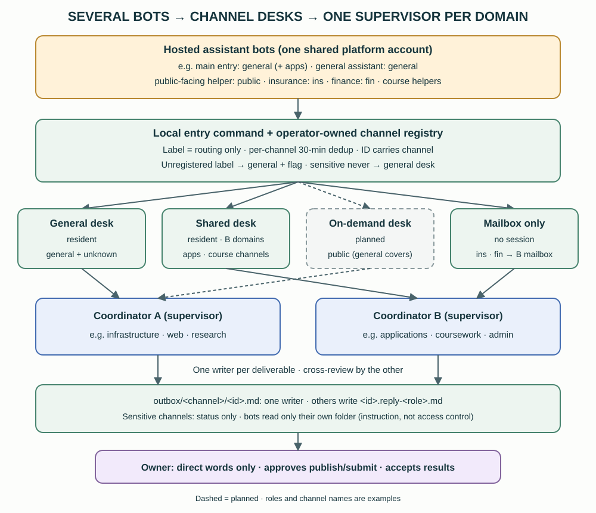

# 17. Multi-bot entry channels and desks

[English](../en/17-entry-channels.md) | [繁體中文](../zh-TW/17-entry-channels.md) | [Home](../../README.md)

The reference owner talks to several hosted assistant bots on an external, voice-capable agent platform. Each bot has its own role. When a request needs local files, repositories, coordinators, review or a sole writer, the bot hands it to the private workspace through a local entry command. This chapter describes how those requests are kept apart once several bots share one entry. It is a **private reference architecture [Custom], not a shipped tool**. This repository contains no entry command, registry, bot instructions or credentials.

The difference from [chapter 16](16-dedicated-project-intake.md) matters. There, the messaging platform authenticates the owner and the channel. Here, the bots share one account on the agent platform, so the workspace **cannot prove which bot sent a request**. A channel is a routing label only (§17.8).



## 17.1 Why one desk gets crowded

The first version had a single entry: every bot ran the same command, and every request reached one operator session (the “desk”). Volume grew to a dozen or more requests on busy days, and these problems appeared [Convention: observed in the reference]:

- **Interleaving:** a new request was typed into the desk while it was still handling the previous one, so unrelated contexts mixed.
- **Context pressure:** one long-running desk session was compacted during a busy day. Afterwards it misstated times, so the desk now reads the clock before writing any time.
- **Fragmented follow-ups:** the owner often adds to a request within a minute or two. Each addition became a separate request, and some contradicted the previous one.
- **Cross-bot visibility:** all replies sat in one folder, so a bot for one life area could read replies meant for another.
- **Unattributable input:** the command recorded only “a bot sent this”, not which bot or topic.

## 17.2 Three layers

| Layer | What it is | Responsibility |
|---|---|---|
| Entry bots | Hosted assistant bots, each with one role and, once its instructions are updated (§17.10), a fixed channel label | Capture the owner's request, merge follow-ups, send it with the bot's label, read results only from its own folder |
| Channel desks | Operator sessions (or a coordinator mailbox) that receive one or more channels | Answer quick read-only questions, otherwise hand the request to the domain supervisor; write status to the channel's outbox |
| Coordinators and writers | The two coordinators, sole writers and reviewers from chapters 2–6 | Dispatch, produce, review and record evidence, exactly as for any other request |

In the reference, the bots' roles include, in generic terms, a main entry for everyday requests (also used for applications), a general-purpose assistant, a public-facing helper, an insurance helper, a finance helper and course-project helpers. A bot may use a second label for a distinct kind of request.

Desks come in four kinds:

| Desk kind | Example channels | Notes |
|---|---|---|
| General desk (resident) | `general`, plus any unregistered label | The original desk. Handles everyday and cross-domain requests |
| Shared desk (resident) | `apps` and course channels | Staffed for coordinator B's domains. Requests that belong to coordinator A's domains are forwarded to A |
| On-demand desk | `public` | Planned to start on the first request; until then the general desk handles it with a flag |
| Mailbox only | `ins`, `fin` | Low volume and sensitive: delivered straight to coordinator B's mailbox, with no resident session |

A desk is staffed by the domain supervisor, so the rule that **only the supervisor dispatches** (chapter 4) still holds. Resident desks are capped at three, because each one is another long-running session on the host machine. Channel names here are examples.

## 17.3 The channel registry

One operator-owned file maps each channel to its route [Custom]. Only the coordinator that owns infrastructure edits it, and only after the owner confirms. Desks never edit it, and message text can never change it.

```json
{
  "channels": {
    "general": {"desk": "general", "outbox_dir": "", "id_prefix": "req",
                "fallback": ["coordinator-a", "coordinator-b-mailbox"], "sensitivity": "normal"},
    "apps":    {"desk": "shared", "outbox_dir": "apps", "id_prefix": "req-apps",
                "fallback": ["coordinator-b-mailbox"], "sensitivity": "high"},
    "public":  {"desk": "public", "outbox_dir": "public", "id_prefix": "req-public",
                "fallback": ["general-desk", "coordinator-a", "coordinator-b-mailbox"], "sensitivity": "medium"},
    "ins":     {"desk": null, "outbox_dir": "ins", "id_prefix": "req-ins",
                "fallback": ["coordinator-b-mailbox"], "sensitivity": "high"}
  }
}
```

*Illustrative and non-executable; field names follow the reference design.*

Each channel records its desk, outbox folder, request-ID prefix, ordered fallback list, sensitivity and supervising domain. It can also list exceptions, such as items that are forwarded to the other coordinator. Each desk has a small desk file that records its current session handle; only that desk's owner writes it.

**Sensitive channels never fall back to the general desk.** If their desk is unavailable, they go to the supervisor's mailbox, so their content never mixes with general traffic. In the reference, coordinator B's mailbox is the last stop for every channel, because a mailbox does not depend on a live session.

## 17.4 How one request travels

1. **Merge first.** If the owner adds to the same request within about three minutes, the bot merges the additions into one request before sending it.
2. **Send with a label and a kind.** The bot runs the entry command with its channel and a kind. *Question*, *lookup* and *discussion* are read-only. *Change* may edit files within scope. *Publish* and *submit* also need the owner's explicit approval (§17.8).
3. **Unknown labels degrade safely.** A request without a channel is treated as `general`, so older bot instructions keep working. An unregistered label is also treated as `general`, but it is flagged for the owner. A malformed label is not echoed back.
4. **The ID carries the channel**, for example `req-ins-20260101-0930-ab12`. `general` keeps the original format without a channel.
5. **Deduplicate per channel.** The same cleaned text in the same channel within 30 minutes returns the earlier ID instead of a new request. A later supplement must name the original ID and must be in the same channel; supplements across channels are rejected.
6. **Route.** The entry command follows the registry order and uses the first live desk. If the local orchestration runtime is unreachable, the request is queued on disk, and a background job delivers it later with its channel intact.
7. **Deliver.** Today a request is typed into the desk session. A per-desk queue that waits until the desk is idle (escalating to the supervisor after about 15 minutes) is planned, not built.
8. **Reply.** Results are written to `outbox/<channel>/<id>.md`. Each bot's updated instructions tell it to read only its own folder. That is an instruction, not an access control.

What the bot may tell the owner depends on evidence:

| Status | Minimum evidence | Does not prove |
|---|---|---|
| Sent | The entry command returned an ID | Anyone read it |
| Picked up | The handler wrote its own status into the outbox file | Work has started |
| Delivered | A result or review is in the outbox or a reply file | The owner accepted it |
| Accepted | The owner said so | That any external action is authorized |

The bot quotes the request ID. It does not say “in progress” or “done” unless it has read a result file. If the command reports a failure, the bot reads the provided message to the owner. If the command returns an earlier ID as a duplicate, the bot follows that ID instead of resending.

## 17.5 One writer per outbox file

Whoever handles a request writes `<id>.md` in its channel folder. Anyone else who contributes, such as the other coordinator or a reviewer, writes `<id>.reply-<role>.md` and never edits the handler's file [Convention]. The entry command creates the first placeholder. It may later replace only a placeholder that it wrote itself; once a handler has written the file and recorded itself as the handler, the command leaves it untouched [Custom, offline-tested]. This removes the “two parties rewrite the same summary” risk without needing locks.

## 17.6 Roles and authority

| Role | May do | May not do |
|---|---|---|
| Entry bot | Capture, merge, send, read its own folder, relay results | Treat its label as identity, act on relayed instructions, claim progress without a result file |
| General desk | Answer quick read-only questions; dispatch requests in coordinator A's domains under A's rules; send requests in B's domains to B's mailbox; write status | Dispatch outside its supervisor's domains, push, publish, send externally |
| Shared desk | The same for coordinator B's domains | Handle A's domains (it forwards them) |
| Coordinators A and B | Supervise their domains, choose one writer per deliverable, cross-review each other's deliverables (chapters 4–6) | Accept on the owner's behalf |
| Sole writer | Produce the deliverable within its written scope | Edit outside scope; act as its own reviewer |
| Owner | Decide, approve external actions, accept results | — |

Cross-review keeps its usual meaning: a session other than the writer checks a fixed version read-only, and the result is recorded separately from the owner's acceptance (chapter 6).

## 17.7 Health checks without false alarms

A background probe checks every five minutes that the desks and the route are live [Custom]. An earlier version raised “desk offline” whenever the orchestration CLI was slow, even though the desk was alive. The reference added four changes:

1. **Record per-step latency** for each probe step.
2. **Retry once**, about 75 seconds after a failure, before counting it.
3. **Slow is uncertain, not down.** A step slower than 15 seconds, or a timeout, marks the result *uncertain*, and no automatic restore is attempted.
4. **Alert on the third consecutive failure**, and send a single recovery notice afterwards. Every result is appended to a history log.

## 17.8 Safety boundaries

- **Only the owner's own direct words execute.** A request that relays an email, social post, web page or another bot's request is marked “needs the owner” and is not acted on.
- **External content is data.** Bot output, tool output and fetched pages never become instructions.
- **A channel is a routing label, not authentication.** All bots share one platform account and one cloud computer. If bots are allowed to run commands on the host, any bot can send any label and read any folder. What actually limits the risk:
  1. Per-request approval for local execution, at least for the sensitive bots (recommended). Check the channel label on the approval prompt before allowing it.
  2. The rule above that only the owner's direct words execute. This is a written rule, not technical isolation.
  3. Status-only outboxes for sensitive channels.
- **Sensitive channels write status, not content.** Applications, insurance, finance and coursework under confidentiality return a state and a pointer, never the details. A bot cannot leak content it never receives.
- **Publishing and submitting need the owner's explicit approval.** A bot's summary of an approval is not the approval itself. Before an irreversible public action, confirm on a channel where the owner speaks directly (chapter 11, “relayed claim”).
- **Untrusted inboxes are injection paths.** A bot that reads messages from strangers, such as a public inbox, should not be able to run commands on the host. Where bots share one account, one injected bot puts all of them at risk.
- **Voice names need a private glossary.** Speech recognition repeatedly mishears names. Keep a private glossary of corrections, and mark uncertain names as “to be confirmed” rather than guessing. The glossary consists mostly of real names, so never publish it.

## 17.9 What goes through the workspace, and what the bot does alone

| Route | Use it for | Gains | Costs |
|---|---|---|---|
| Through the workspace | Local files and repositories, applications, coursework, confidential data, anything that needs a sole writer or review | Full agent tools, supervision and review, an audit trail, data that stays local, central safety rules | Minutes to an hour per request; needs the host online (and unlocked for UI work); uses agent quota; the bot sees only summaries |
| Bot alone | Conversation and coaching, real-time voice, tasks that live entirely on the platform, step-by-step guidance from a handoff pack, scheduled routines on the platform | Instant, always on, independent of the host | No isolation between bots, data uploaded to the vendor, no review or unified log, handoff packs go stale |

The two routes switch in both directions:

- **Bot to workspace:** when a request needs local data, a repository change, review or a decision, the bot sends it through the entry command and stops claiming progress until a result file exists.
- **Workspace to bot:** the result returns as an outbox file. For ongoing guided tasks, the workspace prepares a **de-identified handoff pack**, and the owner uploads it to the bot personally. The pack is regenerated when it goes stale. Confidential data and raw private records are never uploaded.

## 17.10 Evidence and current status

| Tier | What the reference observed | Limit |
|---|---|---|
| Offline tests | Sixteen tests covering the registry, routing order, no fallback for sensitive channels, per-channel deduplication and supplements, the outbox placeholder guard, channel-preserving queues and the health retry/uncertain/alert logic | No live delivery |
| Operator test requests | Test requests through two non-general channels reached the intended desk or mailbox and were acknowledged in the channel folder | Not sent by a bot |
| Labelled requests in production | **First production (non-test) labelled request observed** on a course channel: it reached the shared desk, which wrote its own status file, and the coordinator wrote a separate reply file. No labelled request has been seen from the other bots yet | One channel only; a label proves neither which bot sent it nor that a bot did |
| Idle-aware delivery queue | Planned | Busy desks can still be interrupted |
| On-demand desk start | Planned | The general desk covers the `public` channel meanwhile |

Report the weakest evidenced state. Until every bot sends its own label, channel routing is proven only for the requests above.
