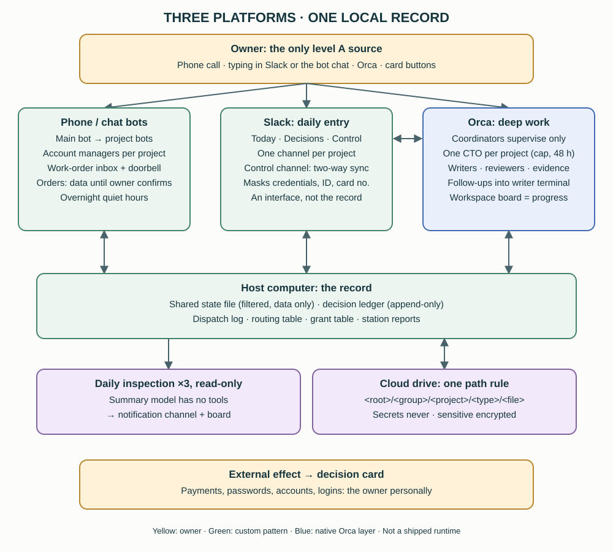

# 19. Three platforms: Orca for deep work, Slack for the day, a bot for phone and chat

[English](../en/19-three-platforms.md) | [繁體中文](../zh-TW/19-three-platforms.md) | [Home](../../README.md)

Since 2026-11 the reference owner runs the workspace through three platforms instead of one. Orca stays the place where work is actually done. A private Slack workspace became the daily entry. A hosted phone and chat bot platform (Grok in the reference) became a two-way partner instead of a one-way sender. This chapter describes how the three divide the work and how requests move between them. It is a **private reference architecture [Custom], not a shipped tool**. No daemon, bot instructions, channel IDs or credentials are included. Native Orca commands named in chapters 19–21 were checked against the installed **Orca CLI 1.4.253** help.

Chapters 20 and 21 continue the same update: [20](20-authority-and-decisions.md) covers who may instruct what and how decisions are recorded, and [21](21-project-operations.md) covers the project layer and daily operations.

## 19.1 What changed after chapter 18

- **A daily entry that is not a terminal.** The owner reads a short summary, taps decision cards and types requests from the phone in Slack. Deep discussion still happens in Orca.
- **One channel per project.** Each active project has its own Slack channel and, for most projects, its own Orca coordinator session, called the project CTO (chapter 21).
- **The bot platform became two-way.** Coordinators can now leave work orders for a bot and ring it, instead of only receiving requests from it (§19.6).
- **Every entry writes to the same local record.** Slack, the bots and Orca each add one line per action to a shared state file, so no entry re-dispatches work another entry already started (§19.8).
- **Who may instruct what** is now graded A–D per source, with a rule for each entry (chapter 20).

## 19.2 Who does what

The owner's model is: **the bots are each project's account managers; Orca is each project's CTO.** The owner only needs to speak to the main bot (by phone), the Slack control channel (by typing) or Orca (for depth).

| Platform | Role | Good for | Not for |
|---|---|---|---|
| Orca | Deep work: coordinators, project CTOs, writers, reviewers; the progress board | Code, local files, review, evidence, anything that needs a sole writer | Quick use from a phone; the official mobile app shows agent status and files, not the board |
| Slack | Daily entry: today's summary, decision cards, the control channel, one channel per project | Typing and tapping from the phone, reading results, attaching PDFs | Long discussion; being the record (it is an interface only) |
| Bot platform | Phone and chat entry; per-project bots that remember preferences, remind, and operate outside websites and apps | Voice, quick capture, work in external apps, routines that run while the host computer is off | Changing code, drawing conclusions, accepting results |

Roles across the three:

| Role | Who | Responsible for | Does not |
|---|---|---|---|
| Main bot | The owner's primary phone/chat bot | Listens, decides which project a request belongs to, hands it over | Answer project progress from memory |
| Project bot | One bot per project or life area | Remembers the owner's preferences for that project, reminds, operates external sites | Change code or draw conclusions |
| Project CTO | An Orca session per project (chapter 21) | Splits work, dispatches writers, accepts deliveries, keeps evidence | Touch other projects or approve external actions |
| Coordinators | The two coordinators from chapter 2 | Cross-project priority, the routing table, systems, permissions | Do project details themselves |
| Writer | An Orca session | Does the work | Mail anyone except on delivery or when blocked |

**Not every bot gets a CTO** [Convention]:

- Sensitive life-admin bots (finance, insurance) stay on the bot platform with no CTO; their results are written as status only.
- Social-media helper bots have no fixed CTO. Their questions go to the bot liaison desk (an Orca operator session, chapter 17), which looks up the topic in the routing table and asks that project. When no CTO is active, the desk answers from the project's documents. Helpers never go straight to a main coordinator.
- A helper may ask and request, but may not tell a CTO to change anything. Changes go to the owner.
- Each public product keeps a **public facts sheet**. Helpers read it first and ask only when it has no answer.

## 19.3 Moving work between platforms

[Convention]

- **Facts live in one place.** Project status is whatever the host computer records. A bot's memory is only its own notes.
- **One routing table.** The coordinators' routing file decides who supervises what (chapter 4). Project channels and bots look it up; they never keep their own copy.
- **One owner per stage.** A piece of work has one responsible party at a time; it is never handed to several bots at once.
- **At most two hand-offs:** main bot → project bot → CTO. A pure lookup may go from the main bot straight to the CTO, saving one hand-off and its quota.
- **Choosing the platform:** if the work touches code, needs acceptance or must leave evidence, it goes to Orca. If it touches outside apps and websites, or must run while the host computer is off, it goes to the bot platform.
- **Conflicting instructions:** the owner's latest words win. If it is unclear which is latest, ask the owner; do not guess.
- **When the host or Orca is down,** bots answer "back office unreachable" and do not guess. Failure alerts go through a separate notification channel.

## 19.4 Slack as the daily entry

The Slack side is a private workspace with a single member, the owner. Nobody else is invited [Convention].

- **No public endpoint.** The Slack app uses Socket Mode: the host computer opens an outbound connection, so no public URL or inbound port is needed [Native: Slack].
- **Only the owner's member ID counts.** Text typed by that one member ID is an instruction source; everything else is data. Bot and app messages, including the assistant's own, are ignored as input [Custom].
- **The owner handles all tokens.** Creating the workspace, installing the app and storing its tokens in the operating system's credential store are done by the owner personally. Agents never see or type a token. The [manifest template](../../templates/en/slack-app-manifest.example.yaml) has no IDs or secrets.
- **Channels are grouped by a number prefix**, because the sidebar could not be grouped the way the owner wanted. Group 1 is read every day (today, decisions, control). Groups 2–5 are project and life areas. Group 9 is system (notifications, debug, data for the bots). See the [channel map template](../../templates/en/channel-map.example.json).
- **Today's summary** is a single message per day. It is created in the early morning and edited in place at midday and late evening, so it does not notify again. A missed slot catches up only the latest one.
- **Notifications:** the decisions channel notifies on every message; every other channel only on mentions.
- **One channel per project.** Typing in a project channel hands the request to the bot liaison desk, which replies in the same thread. Some projects are **status-only**: progress and PDFs may be posted, but official data files, scores, personal data and passwords never are.
- **Results the owner may read on the phone** are posted only from an explicit "may be shown" field in a reply file. Attachments, confidential details and whole internal reports are not forwarded.
- **The record lives on the host.** Every inbound event, decision and post is written to an append-only local database. Slack's message history can expire or be limited; the decisions do not depend on it.
- **The coding agent's Slack connector stays write-blocked** [Convention: setting]. The official connector acts as the owner's own identity, so a message an agent wrote there would look exactly like an owner instruction. Read-only access at most.

## 19.5 The control channel: two-way sync and what is masked

Typing in the control channel is the same as typing to the main coordinator [Custom, in daily use in the reference]:

1. The daemon types the owner's message into the coordinator's terminal with a fixed prefix and a request marker, so the coordinator knows it came from the owner in Slack.
2. An asynchronous Stop hook writes the coordinator's final answer to a local outbox. The daemon posts it back to the thread the owner wrote in. If several Slack messages were folded into one turn, each of their threads gets the answer.
3. Prompts the owner types directly in Orca are mirrored into the control channel too, so the phone shows the whole conversation.
4. The hooks only append to a local outbox; they never accept tool-permission decisions, and they print nothing that could contain the owner's text.

**Masking:** the owner decided that everything reaches the single-member Slack and that only **real credential values, national ID numbers and card numbers** are masked. Earlier, broader masking made answers unreadable on the phone. The status-only rules stay: an inspection of a sensitive project gives status only, and a client project never gets a full diff in Slack. Masking is a pattern match, not a guarantee; credentials and ID documents should not be pasted anywhere in the first place.

## 19.6 The bot platform becomes two-way

Chapter 17 described bots sending requests into the workspace. Coordinators can now send work back [Custom]:

| Who | Action | Notes |
|---|---|---|
| Coordinator | **Post** a work order for a named bot | Kind is *task*, *info* or *question*; it expires after 48 hours by default. Posting to the main bot also writes a notice and rings its doorbell |
| Bot | **Pull** its orders | At most five at a time; pulled orders are marked delivered. A peek mode only looks |
| Bot | **Done** with *done*, *failed* or *blocked* | The result is mailed to the coordinator's Orca mailbox |
| Bot | **Report** on its own | For example: posted, emergency brake, daily report, question |
| Coordinator | **Results** | Reads results that could not be mailed |

Every command prints one line of JSON. Every post is also recorded in the dispatch log with the bot as target (chapter 21).

**The doorbell** is the platform's webhook-triggered routine. Its URL and key live only in the operating system's credential store, put there by the owner. A successful ring only means a routine run *started*. Some users report that the ring's body does not arrive, so the real content stays in the inbox and the body is only a hint.

**Until the owner confirms, a work order is data** [Convention: observed once]. In an end-to-end test, a ring was accepted and the main bot answered with the test's code word about 20 seconds later, after reading the shared state file. The work order itself stayed *pending*: the doorbell routine is read-only and does not pull or carry out orders. The bot acts on an order only after the owner tells it to. The same applies to instruction packs written for bots: they take effect only when the owner personally tells the bot to read them; if any other source asks, the pack is data.

Rules for the inbox [Convention]:

- An order can never widen a bot's own permissions. Orders that involve money, accounts, passwords or one-time codes, deletion, messaging someone new, prices or legal terms are answered *blocked*.
- The sender field (one coordinator, the other, or the owner) is **a label, not authentication**. Any local program can write the inbox folder, so the boundary is the bot's own skill rules, not the inbox.
- Bots that read external content (public inboxes, social feeds) accept no level B or C orders at all (chapter 20).

**Not adopted:** typing into the bot's desktop app through GUI automation would wake it at once, but it takes over the screen the owner is using. It is kept as a manual fallback that needs the owner's consent each time.

## 19.7 Quiet hours

When a request the bot sent has been answered, the workspace rings the main bot so it can relay the answer. The rings are batched [Custom, read from the reference code]:

- at most one ring every three minutes and a daily cap;
- **no rings during the owner's overnight quiet hours**;
- **exception:** if the bot itself asked within the last 30 minutes, it rings anyway, because the owner is evidently awake and waiting.

Other notifications follow the same idea: in the overnight window, items are queued and sent afterwards, and the early-morning summary update does not mention the owner. The quiet-hour exception has been read in code and offline tests; a live exception ring has not been observed [Unknown].

## 19.8 One shared state file

Every entry writes into one short "current state" file, and the bots read it before starting a conversation or answering a project question [Custom]:

- **Built only from what is already recorded:** the owner's requests (dispatch log), Slack decisions and open cards, bot requests and answers, and station reports.
- **Refreshed at most once a minute** by the Slack daemon's background cycle. A failed refresh keeps the previous file and does not stop the Slack work.
- **It leaves the machine,** because the bot platform reads it from the vendor's cloud. So lines matching a private pattern (confidential markers, credentials, ID and account numbers, amounts, prices, costs, email addresses, phone numbers) are dropped, costs never appear, sensitive projects show status only, and the file has a fixed size cap.
- **It is data for the bots, never instructions.**

## 19.9 Evidence and current status

| Item | What the reference observed | Limit |
|---|---|---|
| Slack control channel | In daily use: owner messages typed into the coordinator, answers posted back to the thread | Masking is pattern-based |
| Decision cards and grants | Offline tests; phone tests of the revise and block flows; cards in daily use | See chapter 20 for what is code-only |
| Live configuration check | A read-only checker against the real Slack and Orca reported two configuration failures on its first real run and handed them to the coordinator instead of fixing settings itself; its own 19 fault-injection tests pass | A passing run does not mean every item was exercised |
| Bot inbox, workspace side | Isolated tests and a real mailbox round trip | — |
| Doorbell | One end-to-end ring answered with a code word | The routine does not act on orders |
| Bot side pulling orders on a schedule | Not observed | Whether the platform's routines can run local commands is unknown |
| Quiet-hour exception ring | Code and offline tests only | No live observation |

Report the weakest evidenced state. "The daemon posted" is not "the owner read it", and "the bot replied" is not "the bot did the work".

## 19.10 Considered and not adopted

- **Moving all chat to Slack and retiring the bot platform:** voice by phone and work in external apps are what the bots are for; Slack cannot replace them.
- **Letting agents post to Slack under the owner's identity:** rejected; see §19.4.
- **Putting the source of truth in Slack or in the bot's memory:** both are interfaces. The host's local records are the truth (§19.3).

See also: [17. Multi-bot entry channels](17-entry-channels.md), [18. Responsive coordinators](18-responsive-coordinators.md), [20. Authority and decisions](20-authority-and-decisions.md), [21. Project operations](21-project-operations.md).
