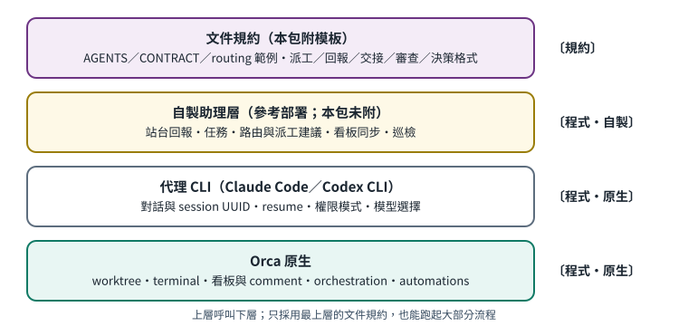

# 第 2 章　整體架構：一件事從誰流到誰

[English](../en/02-architecture.md) | [繁體中文](../zh-TW/02-architecture.md) | [Home](../../README.md)


## 2.1 六個角色

一件事情從 User 提出，到最後被接受或對外送出，會經過下面這條鏈：

```
User → 雙總控（A／B）→ 領域（domain）→ 單一 writer → 獨立 reviewer → User 驗收／外部動作
```

| 角色 | 由誰擔任 | 負責 | 不負責 |
|---|---|---|---|
| **User** | 使用者本人 | 提需求、做決定、最終驗收、授權每一個對外動作 | 逐行監工 |
| **督導總控（primary）** | 依路由表決定是 A 或 B | 收件、判斷派工方式、寫派工訊息、追蹤阻塞、整理驗收證據 | 自己下場做大部分實作（例外見 4.3） |
| **核對總控（reviewer）** | 另一位總控 | 對重要交付做獨立、只讀的核對 | 代替 User 驗收 |
| **領域（domain）** | 路由表裡的一個分類 | 決定「這件事歸誰督導、誰核對」 | 決定誰執行 |
| **writer** | 專案底下的某一個聊天室 | 在規定範圍內實際製作，附自測證據交付 | 對外動作、派更多代理（除非派工訊息允許） |
| **獨立 reviewer** | 不同於 writer 的代理（通常是核對總控，或它派出的唯讀審查者） | 綁定特定版本做審查，回報問題與嚴重度 | 修改被審查的檔案 |

## 2.2 為什麼要「雙」總控

- **互相制衡**：兩個不同供應商的代理有不同的盲點。讓 A 督導的事由 B 核對、B 督導的事由 A 核對，可以抓到單一代理自我驗證抓不到的錯。
- **分攤負載**：每位總控只督導自己的領域，聊天室上下文不會爆。
- **備援**：一位總控暫停（額度用完、User 指定休息）時，由該領域的核對者代理督導。參考部署的自製路由工具會自動算出「目前代理人是誰」〔程式・自製：路由查詢會比對 available 與 unavailable_until〕，但「代理人真的接手做事」仍是〔規約〕。

## 2.3 三層責任不能混

參考部署把責任分成三層，路由只決定第二、三層：

1. **執行層**：各專案原本的聊天室。它們維護自己專案的 canonical 檔案（例如專案自己的 `STATUS.md`、待辦表）。
2. **督導層**：總控。排序、派工、追蹤、整理證據。
3. **核對層**：另一位總控。獨立核對重要交付。

路由**不改變執行者**，也**不搬動**各專案的 canonical 檔案。總控只是「彙整」各專案的狀態，不是取代它。〔規約〕

## 2.4 人工關卡：哪些事一定要 User 本人

下列動作不論路由到誰、不論代理的權限模式多寬，都需要 User **對該次動作**的明確授權〔規約〕：

- 寄信、傳訊息給外部的人
- 送出申請、表單、正式文件
- 付款、訂閱、任何新增支出
- 公開分享、公開發布、部署到公開網址
- 建立新帳號、變更帳號權限
- 刪除不可回復的資料

一個實用的判斷方式：**做了之後能不能無痛撤回？** 不能撤回的，就要確認授權：

- 先查這件事是否**已有可追溯的 User 明確授權**（哪個對話、哪句話），而且這次動作仍在該授權的範圍、對象、時間與版本之內。若是，照授權執行，不必重複詢問。
- 沒有授權、授權範圍不清（例如沒說哪個版本、哪個時段），或已超出原範圍：先把成果做到「可審查、可一鍵執行」的狀態，再向 User 確認缺少的那一項。

Orca 本身也有一個相關的原生保護：把檔案發布成公開連結（artifacts share）預設關閉，只有人可以在桌面版設定裡打開，沒有 CLI 方式可以開〔程式・原生：`orca skills get orca-cli` 的 Artifacts 段落〕。但這只涵蓋 Orca 自己的發布功能，不涵蓋代理用其他工具對外寄送。

## 2.5 原生與自製的分界



| 層 | 內容 | 本包是否附帶 |
|---|---|---|
| Orca 原生 | 工作區（worktree / folder）、終端、終端讀寫等待、工作區看板欄位與 comment、orchestration 的 Run／Task／Dispatch／訊息／決策關卡、排程 automations | 否，需自行安裝 Orca |
| 代理 CLI 原生 | Claude Code、Codex CLI 各自的對話、恢復（resume）、權限模式、模型選擇 | 否 |
| 自製助理層（參考部署） | 共同契約、站台回報、任務資料庫、路由表與派工建議、看板同步、定時巡檢 | **否**，只附說明與模板 |
| 文件規約 | AGENTS／CLAUDE 規則檔、派工訊息格式、審查格式、交接格式 | **是**，在 `templates/zh-TW/` |
| 採用工具 | 安全複製模板、手冊建置與檢查腳本 | **是**；不會替你啟動代理 |
| 客戶訊息入口（選用） | allowlist 收件、無工具回覆、只出預覽的修改提議、私人審查頻道（第 15 章） | 否，只說明架構 |
| 評估中的外部代理產品 | 只考慮用於非敏感工作的桌面代理（5.8） | 否；受限試驗，未證明可正式上線 |
| 多 bot 入口（選用） | 託管助理 bot 的頻道登記表、分機與分頻道 outbox（第 17 章） | 否，只說明架構 |

2026-10 起，參考部署派 writer 一律用原生受監督 worker：每位總控保持一個長駐 Run，每個案子是其中一個 Task（第 14 章）。私人帳本仍記錄「User 要什麼、是否已驗收」；Orca 記錄「誰在執行、這次嘗試是否已結算」。

你可以只採用「文件規約」這一層，就能跑起本手冊大部分流程；自製助理層是讓它更省力、更可追蹤的加分項。

## 2.6 多種入口，共用執行層

擁有者的 Discord 課程／專案頻道（[第 16 章](16-dedicated-project-intake.md)）與客戶 LINE 入口分別使用自己的身份、registry 與 profile。前者固定綁專案；後者的客戶意圖不等於 User 授權。圖中的選用語音橋接只是整合位置，不宣稱任何語音平台已支援或驗證。這些自製入口可交接給督導路由與原生 mailbox；只有督導選定 writer 後才進入原生 Run／Task／Dispatch 執行。直接在 Orca 交辦仍然可用。託管助理 bot 也可以經頻道分機進來（[第 17 章](17-entry-channels.md)）；那裡平台無法證明是哪個 bot 送的，所以頻道只是路由標籤，不是身分。
