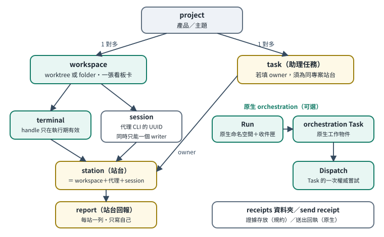

# 第 3 章　名詞與綁定關係

[English](../en/03-concepts.md) | [繁體中文](../zh-TW/03-concepts.md) | [Home](../../README.md)

多代理工作最常出錯的地方，是把不同層的東西當成同一個。例如把「工作區」當成「回報者」，或把 Orca 的 `task` 當成自製助理的 `task`。這一章逐一定義。

## 3.1 定義總表

| 名詞 | 是什麼 | 來源 | 識別方式（範例） | 標記 |
|---|---|---|---|---|
| **project（專案）** | 一個產品、課程、研究主題等邏輯單位，底下可有多個工作區 | Orca 原生有 `orca project list`；參考部署另外自己算了一個專案 ID | `P-EXAMPLE-WEB-A` | 原生／自製兩套，對應關係〔未知〕 |
| **workspace（工作區）** | Orca 追蹤的一個 git worktree 或資料夾，含它的終端、瀏覽器分頁與看板卡片 | Orca 原生 | `id:<repoId>::<路徑>`、`path:<路徑>`、`active` | 〔程式・原生〕 |
| **terminal（終端）** | Orca 管理的一個終端窗格，可以跑 shell 或代理 TUI | Orca 原生 | `term_EXAMPLE01`（handle 只在該次執行期有效） | 〔程式・原生〕 |
| **session（對話）** | 某個代理 CLI 的一段對話，有自己的 UUID，可用原 UUID 恢復 | 代理 CLI 原生 | `SESSION-EXAMPLE-A` | 〔程式・原生（代理 CLI）〕 |
| **station（站台）** | 一個獨立的「回報者身份」＝ 工作區 ＋ 代理種類 ＋ 對話（或 Orca 窗格） | 自製 | `S-EXAMPLE-A` | 〔程式・自製〕 |
| **report（站台回報）** | 某站台對自己進度的一列自報：狀態、摘要、下一步、證據、阻塞 | 自製 | 每站一列，帶 revision | 〔程式・自製〕 |
| **task（助理任務）** | 總控登記的待辦，跨回合追蹤；有狀態、下一步、優先序、期限、證據、審查者 | 自製 | `T-EXAMPLE0001` | 〔程式・自製〕 |
| **orchestration Task** | Orca 原生的「一份工作」，可設相依、可被派出 | Orca 原生 | 由 `orca orchestration task-create` 回傳 | 〔程式・原生〕 |
| **Run** | Orca 原生的 orchestration 命名空間與總控收件匣；一位總控同一時間只綁一個 Run | Orca 原生 | 由 `orca orchestration run-create` 回傳，例如 `run_EXAMPLE` | 〔程式・原生〕；每位總控一個長駐 Run 是〔規約〕 |
| **Dispatch** | Orca 原生：某個 Task 的「一次具權威的嘗試」 | Orca 原生 | 由 `worker-start` 或 `dispatch` 回傳 | 〔程式・原生〕 |
| **派工（動作）** | 把一件事交給某個聊天室去做的行為，不一定建立 Dispatch | 一般用語 | — | 〔規約〕 |
| **delivery（投遞）** | 交給收件者的一批 mailbox 訊息；沒 ack 就一直重播 | Orca 原生 | `check` 回傳的 `deliveryId` | 〔程式・原生〕 |
| **send receipt（送出回執）** | Orca `terminal send` 回傳的結果，含 `accepted` 與階段（`input_accepted`、`turn_started`） | Orca 原生 | 回傳 JSON | 〔程式・原生〕 |
| **receipts 資料夾（收據）** | 參考部署放交付證據、交接說明、測試輸出的資料夾 | 自製慣例 | `HUB_ROOT/receipts/<主題>-<日期>/` | 〔規約〕 |
| **domain（領域）** | 路由表中的一類事務，決定督導與核對總控 | 自製 | `web_sites`、`research` | 〔程式・自製〕 |

## 3.2 兩個容易混淆的地方

### 「task」有兩種

- **助理任務**（自製）：給 User 和總控看的待辦清單。生命週期見第 6 章。
- **orchestration Task**（Orca 原生）：Orca 用來追蹤「受監督的派工」的物件。一旦用原生的 `worker-start` 派出，Orca 會管理 Dispatch、心跳、`worker_done` 等。

2026-10 初以前，參考部署常用 `orca terminal send` 派工，只用自製的助理任務追蹤。2026-10 起，每一次派 writer 都在總控的長駐 Run 底下用原生 `worker-start`，帳本的 evidence 附上回傳的 `run:`、`task:`、`dispatch:` ID 與 worker 的報告路徑〔規約；見第 14 章〕。選項 ① 的快速問答仍然不建立原生 Task。兩邊的紀錄沒有程式自動綁定。

### 「receipt」也有兩種

- Orca 送出輸入後的回執（`accepted: true` 只代表輸入被接受，不代表代理已開始處理；要證明已開始，要看 `turn_started` 階段或加 `--wait-submit`）〔程式・原生：`orca skills get orca-cli` 的 Terminal rules〕。
- 參考部署的 `receipts/` 資料夾，是交付證據的存放位置〔規約〕。

## 3.3 綁定規則

1. **一個工作區 = 一張看板卡片**。同一工作區裡有幾個聊天室，看板上都還是一張卡〔程式・原生，參考部署觀察；版本可能改變〕。要看每個聊天室各自的狀態，要用其他介面（例如 Orca 的實驗性 Agent Dashboard，可用性〔未知〕）。
2. **一個 session 同一時間只能有一個 writer**。不要在兩個終端同時恢復同一個 session UUID〔規約〕。
3. **站台只回報自己**。同一個專案底下的兩個聊天室是兩個站台，各寫各的一列，不互相覆蓋〔程式・自製：回報只更新呼叫者自己的那一列〕。
4. **project、workspace、station、task 不能互換**。任務要掛在專案上，負責人要是「該專案內的某個站台」〔程式・自製：**若有填** owner 而它不屬於該專案會被拒絕；但 owner 可以省略，「每個任務都要有 owner」是規約〕。
5. **terminal handle 是執行期的**。Orca 重啟後 handle 可能失效，要重新 `orca terminal list` 取得新 handle，而且只對新 handle 送，不要新舊各送一次〔程式・原生＋規約〕。
6. **站台身份是歸屬檢查，不是身份驗證**。參考部署依呼叫時提供的工作區、代理種類、session 或站台 ID 對應站台，只檢查工作區與代理種類是否相符；同一台機器上權限足夠的代理仍可以指定別的 ID。它防的是「搞錯」，不是「冒用」〔程式・自製的限制〕。

## 3.4 canonical 檔案 vs 總控彙整

| | canonical（正本） | 總控彙整（投影） |
|---|---|---|
| 誰寫 | 該專案自己的聊天室 | 總控或自製同步程式 |
| 例子 | `PROJECT_ROOT/STATUS.md`、專案自己的待辦 | 個人看板、每日摘要、看板卡片 comment |
| 衝突時 | **以正本為準** | 重新從正本產生 |
| 可以手改嗎 | 可以，依專案自己的規則 | 不要。參考部署標明這些是「產生檔」，改了會被下次同步覆蓋 |

參考部署的收集程式以**唯讀**方式讀各專案的狀態來源，並保留「來源檔的修改時間」，不會把「掃描時間」冒充成「內容查核時間」；來源讀不到時顯示「未知」，不推定為完成〔程式・自製＋規約〕。

## 3.5 參考部署的自製 CLI 介面摘要（未隨附）

以下只是讓你理解參考部署怎麼運作的**介面摘要**。本包沒有這些程式；若要用，需自行實作（見第 8 章）。

| 子命令 | 用途 | 強制行為〔程式・自製〕 |
|---|---|---|
| `brief` | 依目前工作區、代理種類、session 取得自己的站台身份、契約 hash、目前回報 revision、本專案未完成任務 | 找不到已登記的工作區就報錯；不猜別人的站台 |
| `join` | 確認已讀共同契約 | hash 必須完全等於目前契約的 sha256，否則拒絕 |
| `report` | 更新自己站台的回報 | 未 join 目前契約不能回報；必須附 summary 與 next；`review`／`done` 必須附 evidence；`blocked` 必須附 blocker；revision 不符就拒絕；完全相同的回報視為 no-op；每列都標「未驗收」 |
| `task-add` | 登記任務 | 相同 key 重送會去重；若提供 owner，必須是該專案的站台（owner 可省略） |
| `task-update` | 推進任務狀態 | revision 不符就拒絕；`review`／`done` 必須附 evidence；`done` 必須同時有 review-note 與 reviewer（只能是 `coordinator_review` 或 `user_confirmed`） |
| `task-list`／`overview`／`doctor` | 唯讀檢視、健康檢查 | — |
| `sync` | 讀取 Orca 與各來源，重建彙整檢視，推送看板 | 不啟動代理、不派工；加 `--ensure-rules` 時會在已登記的工作區寫入／更新規則入口檔（先備份） |

路由工具（另一支自製 CLI）的子命令：`show`、`validate`、`audit`、`triage`、`who`、`assign`、`unassign`、`set-domain`、`availability`、`set-project`。寫入時會加鎖、先備份、版本號加一、寫 changelog、驗證失敗就拒絕寫入，並支援 `--expect-version` 防止覆蓋別人剛做的修改〔程式・自製〕。

看板同步工具：預設只試算，加 `--apply` 才會透過原生 `orca worktree set` 寫入卡片欄位與 comment〔程式・自製，寫入動作本身是原生命令〕。
