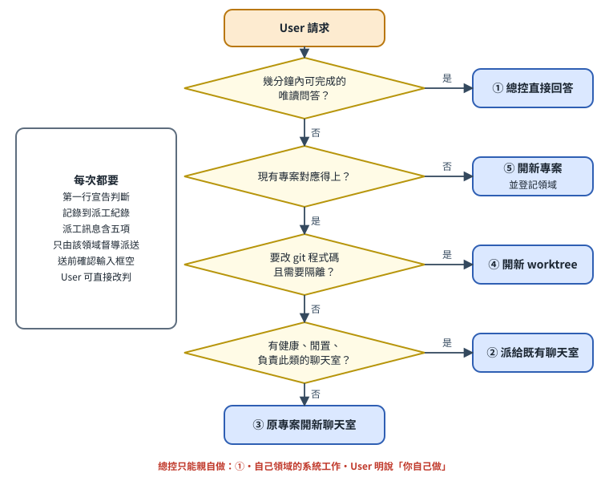
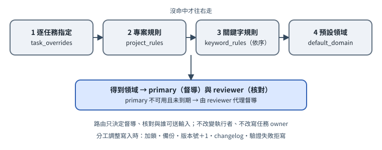

# 第 4 章　派工判斷 ①–⑤ 與路由

[English](../en/04-dispatch-routing.md) | [繁體中文](../zh-TW/04-dispatch-routing.md) | [Home](../../README.md)

## 4.1 每個請求都先判斷

總控收到 User 的任何請求，動手前先做一個判斷，並在回覆的**第一行**宣告〔規約〕：

```
判斷：<編號> <處理方式>｜<對象>｜<一句理由>
```

例如：

```
判斷：② 派給既有聊天室｜網站A 主聊天室｜屬網站A 的文案修改，該聊天室閒置且健康
```

User 看到後可以直接改判（例如「改成 ④，開新 worktree」）。宣告的目的是讓 User 在總控動手前有機會攔下錯誤的分派。



## 4.2 五種處理方式

| 編號 | 處理方式 | 何時用 | 由誰做 |
|---|---|---|---|
| ① | 總控直接回答 | 幾分鐘內能完成、**唯讀**的問答或查詢，不需要寫入任何專案檔案 | 總控本人 |
| ② | 派給既有聊天室 | 事情屬於某專案，且該專案有負責此類工作、**健康且閒置**的聊天室 | 該聊天室（由該領域督導派送） |
| ③ | 在原專案開新聊天室 | 有對應專案，但沒有合適聊天室、既有聊天室忙碌，或需要並行 | 同專案的新聊天室 |
| ④ | 開新 worktree | 要修改 git repo 的程式碼，且需要與其他進行中的工作隔離 | 新 worktree 裡的代理（原生 `orca worktree create --agent ...`） |
| ⑤ | 開新專案 | 全新主題，現有專案都對應不上 | 新專案，並在路由表登記它的領域 |

「閒置」的判斷：聊天室不在工作中、不在等待輸入、沒有退回 shell、沒有顯示重連失敗。**送出前一定要確認目標聊天室的輸入框是空的**——灰色的建議文字不是草稿，但 User 自己打到一半的字是〔規約〕。

### 參考部署的建議工具

參考部署有一支自製的 `triage` 子命令，輸入請求文字，會綜合「路由領域」「候選工作區（用關鍵字與工作區名稱比對）」「該工作區聊天室是否閒置」「是否涉及改程式碼」，建議走 ①–⑤ 哪一種，並附上派工訊息骨架〔程式・自製〕。它的判斷是簡單規則（關鍵字），**只是建議**，最後仍由總控判斷〔規約〕。

它判斷聊天室狀態的方法，是讀原生 `orca worktree ps --json` 與 `orca terminal list --json`，再用 `orca terminal show` 看最後一行是否回到 shell 提示字元〔程式・自製，資料來源是原生命令〕。

## 4.3 總控可以親自做的只有三種

1. 選項 ① 的快速唯讀問答。
2. 總控**自己督導的領域**裡的系統工作（例如負責「助理系統維運」領域的那位總控，修自己的看板設定）。
3. User **明確說「你自己做」**的事。

其他一律派出去，而且只能由該領域的督導派送〔規約〕。參考部署把每次判斷記到一個 JSONL 紀錄檔，每日巡檢會統計，並點名「行動型請求卻被總控自己做掉」的情況〔程式・自製：統計與點名是程式；但「每次都記錄」本身是規約〕。

## 4.4 路由：這件事歸誰督導

路由表是一個可調整的資料檔（範例見 `templates/zh-TW/routing.example.json`）。查詢順序**先中先贏**〔程式・自製〕：

1. **逐任務指定**（task overrides）：某個任務明確指定給某領域。
2. **專案規則**（project rules）：任務掛在某個具體專案時，看該專案歸哪個領域。總控自己的「收件匣專案」除外。
3. **關鍵字規則**（keyword rules）：依序比對任務標題，主要用於總控收件匣裡還沒分到專案的事。
4. **預設領域**：都沒命中就進「盤點／未分類」領域，由負責盤點的總控先看再指定。



每個領域有：

- `primary`：督導總控
- `reviewer`：核對總控（必須是另一位）
- `label`：給人看的說明

另外還有：

- 每位總控的 `available`／`unavailable_until`：暫停時由核對者代理，到期自動恢復〔程式・自製：查詢時計算〕。
- 每位總控的 `max_working`：同時進行中的任務上限，超過時 `audit` 會警告〔程式・自製，只警告不阻擋〕。
- `balance_warn_ratio`：兩位總控未完成任務數比例超過此值時警告失衡〔程式・自製，只警告〕。

### 4.4.1 參考部署：目前的 10 個領域分工（匿名）

下表是作者這套部署**現行**的分工，供參考。這是依工作量與習慣決定、可隨時調整的部署設定〔規約＋程式・自製：存在路由資料檔〕，**不是**對兩個模型能力強弱的結論。領域代號已改成通用描述，不含真實 domain key 或專案名稱；`templates/zh-TW/routing.example.json` 仍用 4 類簡化例，方便從小開始。

| # | 領域（通用描述） | 督導（primary） | 核對（reviewer） |
|---|---|---|---|
| 1 | 全案盤點、排序與未分類收件 | 總控 B（Codex） | 總控 A（Claude） |
| 2 | 升學、獎學金、補助、實習等對外申請 | 總控 B | 總控 A |
| 3 | 課程、作業與考試 | 總控 B | 總控 A |
| 4 | 生活行政（保險、帳務、文件） | 總控 B | 總控 A |
| 5 | 創業計畫文件與資金申請 | 總控 B | 總控 A |
| 6 | 社群與活動申請 | 總控 B | 總控 A |
| 7 | 語音／AI 產品開發 | 總控 A | 總控 B |
| 8 | 網站與前端（含共同編輯） | 總控 A | 總控 B |
| 9 | Orca 與個人助理系統維運（含聊天室恢復） | 總控 A | 總控 B |
| 10 | AI 模型、工具與派工方式研究 | 總控 A | 總控 B |

- 每一列都是「一位督導、另一位核對」，確保重要交付有獨立的第二雙眼〔規約〕。
- 總控暫停時，由該領域的核對者代理〔程式・自製：`available`／`unavailable_until`〕。
- 要改分工，用路由工具的指派／設定指令改資料檔，不要手改查詢結果〔規約〕。

## 4.5 誰可以對聊天室送輸入、誰可以恢復

| 動作 | 誰可以 | 標記 |
|---|---|---|
| 讀任何聊天室（`terminal list/show/read`） | 兩位總控都可以 | 〔規約〕 |
| 對某專案聊天室送任務或回覆 | 只有該領域的督導，或 User 本人。另一位想送，先改路由 | 〔規約〕——Orca 本身不限制誰能 `terminal send` |
| 恢復斷線的聊天室 | 由「維運領域」的督導統一負責，不論該聊天室屬哪個領域 | 〔規約〕 |
| 打斷另一位總控自己的聊天室 | 永遠不行 | 〔規約〕 |
| 替任何聊天室送出尚未送出的草稿 | 永遠不行 | 〔規約〕 |
| 修改全域設定、重啟整個 Orca | 不行，只能建議 User | 〔規約〕 |

把「恢復」集中給一位，是為了避免兩位總控同時去恢復同一個 session，造成同一個 UUID 有兩個 writer。

## 4.6 派工訊息必含五項

每一則派給聊天室的訊息都必須包含〔規約〕（模板：`templates/zh-TW/dispatch-message.md`）：

1. **User 的原始需求與成功條件**（原文照貼，加上可驗收的成功條件）
2. **可讀／可寫範圍與禁止事項**（尤其是送件、付款、寄信、公開分享、建帳）
3. **能不能開新終端、能不能啟動其他代理、最大併發數、額度上限**
4. **交付時要附自測證據**
5. **完成後回報自己的站台**

2026-10 版參考部署中，②–⑤ 都把這則訊息當作原生受監督 worker 的 `--spec` 送出；第 5 項另外要求 `worker_done` 帶 `--report-path`（有改檔再加 `--files-modified`）〔規約；第 14 章〕。只有該領域的督導可以啟動這個 worker。

審查類派工另有格式（第 6 章、`templates/zh-TW/review-request.md`）。

## 4.7 記錄判斷

參考部署用自製工具記錄：

```
<路由CLI> triage --text "<User 的請求>" --record --decision <1-5> --target <handle 或路徑> --by <A|B>
```

如果你沒有自製工具，最簡單的替代是在 `HUB_ROOT/receipts/dispatch-log.md` 每次加一行：時間、請求摘要、判斷編號、對象、誰判斷。重點是**可以事後統計**。參考部署寫成 JSON lines；每日唯讀巡檢會統計判斷，並點名「行動型請求卻由總控自己做」的情況〔程式・自製〕。

## 4.8 調整分工

分工是資料，不是規則。User 可以隨時說「把網站A 改給 B 督導」或「這週 A 不在，全部交給 B」。參考部署用路由 CLI 的 `assign`／`set-domain`／`availability`／`set-project` 寫入，不手改檔案〔程式・自製〕。共同契約不因分工調整而改版，所以調整分工**不必**讓所有站台重新確認已讀。

## 4.9 固定頻道不是語意路由

[專屬入口](16-dedicated-project-intake.md)先由操作者維護的頻道綁定選定專案，再通知督導。文字不能改綁定；跨專案需求請到正確頻道，不自動轉送。問答／行動分流使用簡單規則，請明確交辦；收件不會自動選 writer 或啟動 worker。督導仍須核對範圍、暫停指示及適任站台。
