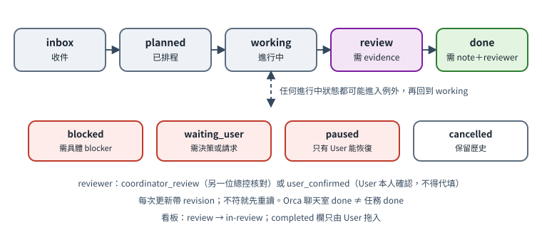

# 第 6 章　任務生命週期、證據與驗收

[English](../en/06-lifecycle-review.md) | [繁體中文](../zh-TW/06-lifecycle-review.md) | [Home](../../README.md)

## 6.1 狀態



常用路徑：

```
inbox → planned → working → review → done
```

例外狀態：

| 狀態 | 意思 | 必要條件 |
|---|---|---|
| `inbox` | 剛收件，還沒排 | 標題與具體下一步〔程式・自製〕 |
| `planned` | 已排定，尚未開始 | — |
| `working` | 有 writer 在做 | — |
| `blocked` | 卡住了 | 必須寫出具體阻塞〔程式・自製，站台回報〕 |
| `waiting_user` | 等 User 決定或提供 | 在 next 寫清楚要 User 做什麼 |
| `review` | 已交付，等核對或驗收 | 必須附 evidence〔程式・自製〕 |
| `done` | 完成 | 必須附 evidence、review-note、reviewer〔程式・自製〕 |
| `paused` | User 要求暫停 | 暫停的事不能因為期限接近就自行恢復〔規約〕 |
| `cancelled` | 取消 | 保留歷史 |

每次更新都要帶上次讀到的 revision（樂觀鎖）；revision 對不上代表別人剛改過，要**先重讀再決定**，不要盲目重試〔程式・自製〕。

## 6.2 每個任務要記的欄位

以下是**每件事應該被記下來的資訊**，不一定都在同一筆紀錄裡。參考部署的任務紀錄本身只有 owner、next、priority、due、source、evidence、review-note、reviewer 等欄位；blocker 寫在站台回報、decision 寫在決策紀錄並在 next 引用、checkpoint 寫在看板卡片 comment。

| 資訊 | 說明（存放位置） |
|---|---|
| owner | 負責站台（任務欄位；若填，必須屬於該專案；可省略，但規約要求補齊） |
| next | 下一個**可執行**的具體步驟，不是「繼續處理」 |
| priority | 1／2／3 |
| due 與 due-kind | `target`（內部目標）、`confirmed_deadline`（已核實的正式期限）、`source_unverified`（來源待核）。只有日期時用本地曆日，不自行捏造鐘點 |
| source | 這件事從哪裡來（User 哪天哪句話、哪份文件） |
| evidence | 產物或證據的路徑（任務欄位） |
| blocker | 卡住的具體原因（站台回報） |
| decision | 需要 User 決定的選項（決策紀錄 `templates/zh-TW/decision-record.md`，next 引用其編號） |
| checkpoint | 工作區卡片上的短進度（卡片 comment，見第 7 章） |

不要把每句話都變成任務。只有需要跨回合追蹤的事才登記；相同 key 重送會去重〔程式・自製〕。

## 6.3 證據

「交付」必須附**自測證據**〔規約〕。參考部署的 CLI 會**拒絕**把沒有 evidence 的任務或回報設成 `review` 或 `done`〔程式・自製〕。所以 writer 說「做完了」但沒附證據時，任務維持 `working`，總控先向 writer 索取證據；「待驗收」只在有證據之後才成立。注意：程式只檢查 evidence 欄位非空，不會驗證檔案內容是否真的證明了什麼。

好的證據：

- 測試指令與輸出（含通過／失敗數）
- 產物的檔案路徑與 SHA-256
- 截圖或逐頁渲染結果（說明看了哪幾頁）
- 回讀結果：寫入後再讀一次，確認內容正確
- 對外動作的回執（只有 User 授權後才會有）

**不是**證據的：

- 「代理說它做完了」
- Orca 顯示該聊天室「done」——那只代表一輪代理活動結束〔規約；參考部署契約明文〕
- 「草稿已備好」不等於「已送出」；「已送出」不等於「已收到回執」；「已收到回執」不等於「正式受理」。每一步要分開記錄。

## 6.4 review 與 done 的差別

| | review | done |
|---|---|---|
| 意思 | writer 交付了，附了證據，**等人核對** | 已有人依證據核對並接受 |
| 誰可以設 | writer 回報、或督導更新 | 只有在有 reviewer 時 |
| 必要欄位 | evidence | evidence ＋ review-note ＋ reviewer |
| reviewer 可以是 | — | `coordinator_review`：另一位總控實際核對了證據；`user_confirmed`：User 本人確實確認 |

`user_confirmed` **絕對不能代填**。總控只能在 User 真的說了「好，我確認」之後，替 User 記錄這件事，並在 review-note 寫明 User 何時、如何確認〔規約；程式・自製只檢查欄位存在，不能判斷真假〕。

另外，站台回報（report）即使寫 `done`，參考部署也會一律標成「未驗收」——它只是負責者自報完成〔程式・自製〕。

## 6.5 版本綁定審查

審查結論必須綁定**特定版本**〔規約〕：

- 審查請求要寫出被審查產物的路徑**與** SHA-256（或 git commit）。
- 審查報告開頭重述它審的是哪個 hash。
- 審查之後產物若有任何修改，原審查結論**自動失效**，要對新 hash 重審（可以只審差異，但要寫明）。
- 驗收時比對：User 拿到的檔案 hash ＝ 審查報告裡的 hash。

參考部署的自製程式**沒有**自動把審查綁到 hash；它只對任務記錄本身做 revision 檢查、對共同契約做 sha256 檢查。版本綁定是靠模板與審查者自律〔規約〕。如果你要實作，最簡單的做法是在任務的 review-note 裡強制寫 `sha256=...`，交付前用腳本比對。

## 6.6 審查類派工格式

所有「審查、檢查、找問題、核對」類派工都用同一格式〔規約〕（`templates/zh-TW/review-request.md`、`templates/zh-TW/review-report.md`）：

1. **只讀**：不得修改被審查的檔案或資料。
2. **結構化回報**：每個問題含位置、嚴重度（高／中／低）、證據、建議。
3. **沒找到問題就直說**，不為了湊數列問題。
4. **督導抽樣覆核**部分問題確認屬實後才轉給 User；不以問題條數評價審查品質。

高風險類別（例如要送出的申請、要公開的網站）在交給 User 手動送出前，應由該領域的核對者以 `coordinator_review` 獨立核對一次〔規約〕。參考部署的 `audit` 只對**一個指定領域**（申請類）、**最高優先序**、狀態為 `waiting_user` 或 `review` 的任務提醒「尚未核對」〔程式・自製〕；其他類別（例如網站）的交叉審查完全靠規約，沒有程式提醒。

## 6.7 跨總控交接

當工作要從總控 A 交給總控 B（例如 A 暫停、或該事要 B 審查）〔規約〕：

1. 把產物與說明放到 `HUB_ROOT/receipts/<主題>-<日期>/`。
2. 寫一份交接說明（`templates/zh-TW/handoff.md`）：原始需求、目前狀態、已完成／未完成、證據路徑與 hash、已知風險、下一步。
3. 更新任務，evidence 指向收據資料夾；需要核對時在 next 寫「請 <B> 核對 <路徑>」。
4. **接手方讀完檔案後才算接手**，並在自己的站台回報。
5. 用 Orca 傳訊息時，`orca orchestration send` 的成功只代表訊息已持久排入，不代表對方已讀或接受〔程式・原生〕。只填終端 handle 當收件人時，Orca 會警告該收件匣在終端關閉後不保證送達，建議改用 `run:<id>` 或 `dispatch:<id>` 定址〔程式・原生，觀察自送出回執的警告〕。

## 6.8 agent done 與 User 接受

| 訊號 | 代表 | 不代表 |
|---|---|---|
| Orca 聊天室顯示 done／idle | 一輪代理活動結束 | 工作完成 |
| 站台回報 `done` | 負責者自報完成 | 已驗收 |
| 任務 `review` | 有證據、等核對 | 已核對 |
| 任務 `done` + `coordinator_review` | 另一位總控核對過證據 | User 接受 |
| 任務 `done` + `user_confirmed` | User 本人確認 | 已對外送出（對外仍是另一個動作） |
| 看板卡片在 completed 欄 | User（或其授權）拖進去 | — 參考部署的同步**不會**自動把卡片移入 completed〔程式・自製〕 |

## 6.9 「講得像做完了」比做錯更危險

做錯但誠實標示的結果，會在審查時被抓到；沒有證據卻「聽起來已經完成」的結果，會跳過審查、直接被 User 當成事實。參考部署因此把過早的完成用語視為更危險的失誤〔規約〕：

1. **沒有證據就不是 done。** `review` 與 `done` 需要可讀的路徑與結果；「應該可以」「看起來沒問題」不是證據。
2. **只說最弱但為真的那句話。** 「已準備」「已送出」「已收到回執」「已受理」只用在真的發生的事（6.3）。草稿不是送件；排入不是已讀；`worker_done` 不是驗收。
3. **來源缺失就顯示未知。** 來源讀不到、站台沒回報、回報過期或 Orca 不可達時，摘要寫「未知／過期」，絕不寫完成（3.4）。
4. **說明沒檢查到的部分。** 交付時把略過的步驟與沒測到的環境，和證據寫在一起。
5. **絕不捏造確認。** `user_confirmed` 需要 User 的原話、時間與管道。

面向客戶的回覆也用輸出 guard 套用同一條規則（15.5）。
