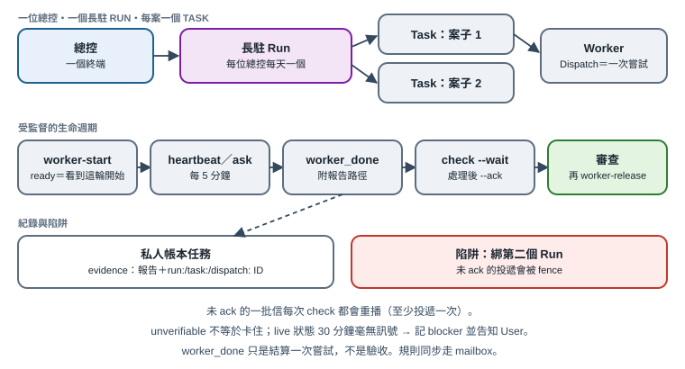

# 第 14 章　Orca 原生編排：每位總控一個長駐 Run

[English](../en/14-native-orchestration.md) | [繁體中文](../zh-TW/14-native-orchestration.md) | [Home](../../README.md)

2026-10 版起，參考部署派 writer 一律改用 **Orca 受監督 worker**，不再只是把派工訊息打進某個終端、然後希望對方有看到。本章說明這套生命週期、最容易踩的陷阱（Run fencing），以及私人帳本怎麼和原生 ID 互相連結。

以下原生行為以 Orca CLI **1.4.220** 的 help，以及同版 tag 的 Orca 開源原始碼（MIT）核對。原始碼路徑相對於 Orca repo，方便你自己查證；之後的版本可能改變。至於「什麼時候用哪個指令」則是〔規約〕。



## 14.1 三層、兩種紀錄

| 層 | 負責 | 識別方式（範例） |
|---|---|---|
| 私人帳本（自製） | User 要什麼、優先序、期限、核對者、驗收 | `T-EXAMPLE0001` |
| Orca Run／Task／Dispatch（原生） | 現在誰在執行、存活狀態、訊息、具權威的那次嘗試 | `run_xxx`、`task_xxx`、`ctx_xxx` |
| 專案檔案（正本） | 產物本身與專案自己的狀態 | `PROJECT_ROOT/STATUS.md` |

帳本仍是 User 唯一要看的待辦清單；原生 Task 代表工作；Dispatch 才是其中一次具權威的嘗試。兩者互補、不重複，也都不取代專案自己的狀態檔〔規約〕。

## 14.2 每位總控一個長駐 Run

一個總控終端**同一時間最多只綁一個 Run**〔程式・原生〕。綁另一個 Run（`run-create` 或 `run-use`）時，consumer generation 會加一，舊 Run 還沒 ack 的投遞會被標成 `fenced`（`src/main/runtime/orchestration/db/runs/run-binding.ts`、`db/messages/role-mailbox-delivery.ts`）。`check` 預設只讀目前綁定的 Run（`messaging/check-run.ts`）。

所以早期「一案一 Run」的習慣，在總控同時督導多案時就會出事：在 B Run 上等待時看不到 A Run 的 `worker_done`；切回 A 又會把 B 還沒處理的那批信 fence 掉。參考部署因此改規則〔規約〕：

1. 每位總控保持**一個長駐 Run**，有未結算工作時跨日保留。
2. 每個案子是這個 Run 底下的一個 **Task**，用 `worker-start --task-title "<案名>"` 建立（子步驟加 `--parent`）。
3. 換日不會自動允許切換 Run。先用 `worker-list` 核對所有 active Dispatch；保留它們的可收件路徑，處理並 ack 舊批次，完成結算與回收決策後，才明確切換。不能把未知存活當成已結束。
4. 寫信給另一位總控時，定址到**對方的**長駐 Run（`--run <對方 Run> --to <對方 handle>`）。

## 14.3 受監督的生命週期

把佔位字換成實際值。先讀你自己版本的 `orca skills get orchestration`：它跟著 binary 一起發佈，是你那個版本的權威說明。

```text
orca orchestration worker-start --run <run> --from <總控 handle> \
  --worktree <current|path:...|new-child> --agent <claude|codex> \
  --task-title "<案名>" --spec "<派工單全文或路徑>" --json
orca orchestration check --run <run> --terminal <總控 handle> --wait \
  --types worker_done,escalation,question --timeout-ms <ms> --json
# 先處理每則訊息、核對完成證據並決定終端歸屬；此例選擇回收。
orca orchestration worker-release --dispatch <dispatchId>
orca orchestration check --run <run> --terminal <總控 handle> --ack <deliveryId> --json
orca orchestration worker-read --dispatch <dispatchId>
```

| 步驟 | 證明了什麼 | 來源 |
|---|---|---|
| `worker-start` 回 `state: ready` | Orca 實際觀察到 worker 這一輪開始了；看不到就回 `start_unknown`，不會樂觀地說成功 | `rpc/methods/orchestration/worker/worker-start-readiness-settlement.ts`〔程式・原生〕 |
| 不是 ready | 看 `failedStage` 處理；不可改用看不見的子代理繞過 | help 說明〔程式・原生〕；禁止繞過是〔規約〕 |
| worker 每 5 分鐘送 heartbeat | 只更新對應 Dispatch 的 `last_heartbeat_at` | `preamble.ts`、`dispatch-completion.ts`〔程式・原生〕 |
| `ask` | 持久的問題串；worker 會阻塞直到總控回覆 | `messaging/ask-methods.ts`〔程式・原生〕 |
| `worker_done` 只送一次，帶 task 與 dispatch ID | 結算該次 Dispatch；舊嘗試晚到的訊息不能結算重試 | `worker-report-settlement.ts`、`lifecycle-reconciliation.ts`〔程式・原生〕 |
| 審查後 `worker-release` | 先保存 transcript，再關掉 Orca 建立的終端 | `db/worker-terminal/worker-terminal-archive.ts`〔程式・原生〕 |

參考部署要求每個 worker 送 `worker_done` 時一定帶 `--report-path <receipts/.../report.md>`，有改檔案再加 `--files-modified`〔規約〕。`worker_done` 是結算這次嘗試，**不是**驗收（見 6.8）。

## 14.4 至少投遞一次：一定要 ack

每個收件匣同一時間最多只有一批未確認的投遞。在你 ack 之前，每次 `check` 都會**原樣重播同一批**（`replayed: true`）〔程式・原生，`role-mailbox-delivery.ts`〕。好處是當機也不會漏信；代價是忘了 `--ack` 的總控會一直重讀舊信。處理完、記錄好，再 ack。

`send` 成功只證明訊息已持久排入，不代表有人讀了（見 6.7）。回執永遠不能代替收件人的回覆。

## 14.5 存活判斷與 heartbeat 過期檢查清單

`worker-list` 會給 `liveness ∈ live｜unverifiable｜exited`、`attention` 清單，以及附可直接執行參數的 `nextAction`（`src/shared/orchestration-fleet-projection.ts`）〔程式・原生〕。「連不上」不等於「死了」：只有擁有該程序的主機提出正面證據，才算 `exited`。

已退役的自動 coordinator 迴圈原本會警告 heartbeat 過期；現行模型沒有任何程式會發出這個警告（唯一呼叫點在 `coordinator.ts`）〔程式・原生的缺口〕。參考部署用一份寫明的檢查清單補上〔規約〕：

1. `liveness: unverifiable` → 不動作，也不當成卡住。
2. `attention` 有 input 或 guidance → 先回覆待處理的 `ask`。
3. 在 `live` 狀態下，**30 分鐘**都沒有 `ready`、`turn_started`、heartbeat、`worker_done` 或提問 → 在帳本任務記 blocker，並提醒 User。
4. 其他情況依 `nextAction` 處理；不能只因為安靜就 stop、abandon 或重試。

## 14.6 等 User：gate 還是 `waiting_user`

`gate-create` 會立刻把原生 Task 擋成 blocked（`db/decision-gates/decision-gate-store.ts`）〔程式・原生〕；帳本的 `waiting_user` 則是 User 實際會看的清單〔程式・自製〕。為了避免兩邊各記一份、慢慢不同步：只有在**有 worker 正被這個決定擋住**時才開 gate，並在帳本任務的 next 寫 `gate:<id>`，gate 解除時兩邊一起更新〔規約〕。登入、同意、帳號這類步驟永遠屬於 User，worker 不得嘗試繞過。

## 14.7 規則同步改走 mailbox

執行中的對話不會自己重讀規則檔。參考部署不再把「請重讀規則」直接打進另一位總控的終端〔規約，2026-10 起〕：

```text
orca orchestration send --run <對方長駐 Run> --to <對方 handle> \
  --type status --subject "請重讀規則" --body "<變更摘要、檔案路徑、前後 hash>"
```

收件人的窗格閒置時，Orca 會自動打一行提醒（「You have N orchestration messages…」）；對方忙碌時不打擾，已有一批未 ack 時也不重複（`mailbox-pointer-delivery.ts`、`formatter.ts`）〔程式・原生〕。這個提醒只針對 `run:` 與 `dispatch:` 收件匣，所以收件人應該已綁定長駐 Run；沒綁 Run 時的行為〔未知〕，第一次使用請先冒煙測試。收件人 ack 並回覆「已重讀＋版本」，才算同步完成〔規約〕。

## 14.8 帳本連到原生 ID

總控把帳本任務轉成 `review` 或 `done` 時，evidence 要同時附報告路徑**以及** `run:<id> task:<id> dispatch:<id>`〔規約〕。稽核時可用 `worker-read --dispatch <id>` 讀保存的 transcript，不必另外截圖。這個連結沒有程式自動綁定；帳本只檢查 evidence 不是空的（見 6.3）。

## 14.9 每次派工指定推理等級（選項）

`worker-start` 支援 `--model` 與 `--effort`（`--effort` 必須搭配 `--model`），並記在 Dispatch 上〔程式・原生〕。逐次指定可以避免為了一件關鍵任務去改全域預設。參考部署把這點列為建議，**尚未**正式採用。

## 14.10 值得照抄的設計

- **規則貼在範例旁邊。** Orca 的 worker preamble 把每條規則寫成它所管的指令上方的註解，用平實語氣而不是大寫強調，因為讀者會錨定範例（`preamble.ts`）。派工單也這樣寫。
- **要有正面證據，否則就是「未知」。** `ready` 需要觀察到這一輪開始；`exited` 需要擁有者的證明。不要把安靜升級成成功或失敗。
- **身份綁在「那一次嘗試」。** 每則訊息都帶 Dispatch ID，舊嘗試不能結算新嘗試。
- **指南跟著 binary 發佈。** `orca skills get` 回傳的是你已安裝版本的指南；引用它，不要抄過時的筆記。

## 14.11 專屬頻道通知不是派工

[第 16 章](16-dedicated-project-intake.md)的自製入口建立私人專案任務後送原生 mailbox 通知，不直接啟動 worker，也不自動綁定原生執行 ID。總控接單、核對暫停與權限、選定 writer 後才進入本章生命週期。session 替換後須核實新收件綁定；成功 enqueue 仍不等於已讀。
