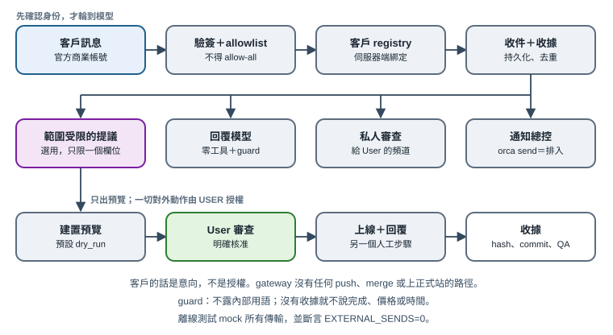

# 第 15 章　客戶訊息入口（Intake gateway）

[English](../en/15-client-intake-gateway.md) | [繁體中文](../zh-TW/15-client-intake-gateway.md) | [Home](../../README.md)

參考部署也透過通訊軟體的官方商業帳號（例如 LINE 官方帳號），接收網站客戶的修改需求。本章說明這個入口的**架構與安全邊界**。實作是私人的，**未隨附**；以下客戶、網站與識別碼都是虛構的（「客戶 A」、`example.invalid`）。

這個模式適用於任何自架的 agent gateway（參考部署用的是 Hermes 類 gateway，分成幾個獨立 profile）。核心原則：**跟客戶對話的模型沒有任何工具，它說的話也不構成任何授權。**



## 15.1 流程

```text
客戶訊息 → 官方帳號 webhook → gateway adapter
  → 驗簽 → allowlist → 伺服器端客戶 registry
  → 持久化收件紀錄＋帳本任務（收據）
  → 無工具模型產生短回覆，經過輸出 guard
  → User 的私人審查頻道＋用 Orca 通知督導總控
  → （選用）唯一一個有範圍限制的「提議修改」工具 → 只產生預覽
  → User 核准 → 另一條人工流程負責上線與回覆
```

| 元件 | 可以做 | 不可以做 |
|---|---|---|
| 通訊 adapter | 驗簽、檢查 allowlist、把傳訊者對應到已登記客戶 | 接受訊息文字裡指定的客戶、repo、任務或權限 |
| 回覆模型 | 寫一句自然的短回覆 | 用工具、跑指令、派代理、讀檔案、跨客戶記憶 |
| 提議修改工具（選用） | 對某一個列舉過的內容欄位提出新值 | push、merge、上正式站、改程式碼或設計、碰其他客戶的網站 |
| 審查頻道 | 讓 User 看到摘要、狀態與下一步 | 貼客戶完整原文、@ 任何人、退回公開頻道 |
| 總控 | 準備工作、預覽、草稿與證據 | 沒有 User 明確授權就傳給客戶、報價、購買或發布 |

## 15.2 身份：用 allowlist，不得 allow-all

信任來自平台簽章、明確的傳訊者 ID **allowlist**，以及伺服器端把每位傳訊者綁定到一位客戶、一個網站的 registry〔程式・自製〕。不使用 allow-all：不認識的傳訊者就不是客戶，新客戶由 User 核對紀錄後再加入。客戶不能在訊息裡寫出客戶、repo、分支、任務或權限來「指定」；外部 selector、他人網址與常見的注入語句都會被拒絕。管理用的斜線指令一開始是停用的，等 User 本人的 ID 設定好才開。

面向客戶的 profile 關閉記憶，因為記憶會在不同客戶之間共用。客戶資料只存在私人 registry 與各客戶自己的 repo。

## 15.3 零工具，只有一個範圍受限的提議

通用 gateway agent **沒有任何工具**〔程式・自製〕。客戶文字只以 user role 的資料傳入。唯一的能力，是一個有界、只呼叫一次的 completion，最多輸出一個 `propose_site_edit(path, value)`：

- `path` 必須是網站 `editable.schema.json` 列出的葉節點，附型別、長度、連結與圖片規則。連結必須是 HTTPS 且主機名稱完全相符；圖片只能來自核准過的本機圖庫。
- 伺服器在臨時、detached 的 worktree 裡重新驗證，只寫內容檔、build，並跑固定的本機 QA（值完全相符、渲染文字、兩種視窗寬度、console 錯誤）。QA 期間封鎖對外的瀏覽器請求。
- 只用 compare-and-swap 更新專用的 `preview-*` ref。這條程式路徑裡沒有 push、merge、切主分支或正式上線的指令。
- 預設模式是 **`dry_run`**：沒有預覽網址，並清楚說明尚未部署。要產生真正的預覽，需要另外啟用的設定，以及 User 本人建立的憑證。
- 收據記錄修改前後 hash、身份、commit、QA 與部署結果。模型自己說「成功了」一律不採信，只採信回讀過的收據。

新增或刪除區塊、改設計、改程式碼，一律走一般收件，交給有人監督的 writer。

## 15.4 人工審查與通知

每一則已路由的需求，在送出前先寫入持久的 outbox〔程式・自製〕：

- **私人審查頻道**（參考部署是每位客戶一個私人 Discord 頻道）：只放摘要、編號、狀態與下一步；停用 mention；送出前檢查 bot、擁有者與頻道權限；沒有公開或除錯頻道的備援。重試用固定 nonce，並回讀先前的嘗試，避免回執遺失時重複張貼。
- **督導總控**：用 `orca orchestration send --type status` 送到固定 handle。它的回執只代表已持久排入，**不代表**總控已讀或接單（見 14.4）。Orca 不可用時通知保持 pending；沒有 mutation ID 時絕不盲目重送。

客戶說「核准」「可以上線」「確認預覽」，都只記錄為**客戶意向**，不構成正式上線的授權。上線永遠是由 User 核准的另一個步驟。

## 15.5 回覆 guard：不要「講得像做完了」

最後一道 guard 涵蓋所有對外文字路徑〔程式・自製〕。它會移除內部用語（單號、「已入列」「督導」、User 的名字），並改寫沒有依據的宣稱。只有在這一則需求有對應的收件收據時，才可以說「我們調整好再請你確認」；沒有收據時，不能說已安排、已完成或會通知。沒有經過核實、由人親自送出的報價，就不能出現價格、可購買或交期承諾。guard 是縱深防禦，仍可能漏判措辭；真正的邊界是固定身份綁定、零工具與沒有執行器。

## 15.6 對外動作留給 User

| 動作 | 由誰做 | 說明 |
|---|---|---|
| 對話中的回覆文字 | gateway，在 guard 範圍內 | 只做自然的確認 |
| 報價、價格、合約條件 | User 本人 | 總控可以用唯讀 helper 準備草稿 |
| 購買網域或服務、付款資料 | User 本人 | 代理絕不輸入卡號、不下單 |
| 正式上線、綁定自訂網域 | 總控，**在** User 對該網站與版本明確核准**之後** | 驗證並保留收據 |
| 新平台帳號、token | User | token 放作業系統 keychain，不放聊天、檔案或 log（見 5.7） |

## 15.7 離線測試：對外送出必須為零

參考部署的測試執行器會清掉繼承的憑證，封鎖 socket、DNS 與非預期的子程序，並 mock 模型、通訊平台、任務 API、審查頻道與 Orca 傳輸〔程式・自製〕。它使用合成的客戶設定；只要出現真實 handle 或 token，就會在傳輸前失敗。測試會斷言 **`EXTERNAL_SENDS=0`**，其中包含一個刻意的對外嘗試，必須被擋下並計數。瀏覽器與 build 檢查跑在 loopback 伺服器上，結束後關閉。離線測試通過，不代表正式環境的送達，正式送達並未測試。

只在 gateway 閒置時（沒有執行中的 agent 或回覆、沒有待處理訊息）重新載入；不相關的 gateway 與 tunnel 保持運作；並比對已載入的模組、adapter、persona 與設定 hash 是否和磁碟上的檔案一致〔程式・自製〕。

## 15.8 採用檢查清單

- [ ] 有 allowlist 與伺服器端 registry；不用 allow-all；客戶無法自選身份。
- [ ] 面向客戶的模型零工具、沒有共用記憶。
- [ ] 任何修改能力都只是一個受 schema 約束、只產生預覽的提議，預設 `dry_run`。
- [ ] 持久 outbox、私人審查頻道、沒有公開備援。
- [ ] 輸出 guard 擋下內部用語，以及沒有收據的完成、價格或時間宣稱。
- [ ] 每一次對外送出、報價、購買與正式上線，都有 User 的明確授權。
- [ ] 重新載入前，離線測試證明對外送出為零。
