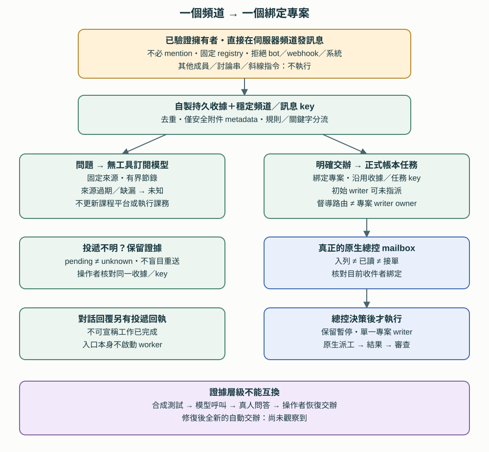

# 第 16 章　Discord 課程與專案專屬入口

[English](../en/16-dedicated-project-intake.md) | [繁體中文](../zh-TW/16-dedicated-project-intake.md) | [Home](../../README.md)

專屬頻道讓已驗證的擁有者固定在同一處詢問某門課或專案，不必提及 bot。這是**私人參考架構，不是隨附的常駐服務**。本 repo 只提供說明與示意模板，沒有 gateway、registry、憑證或私人來源。客戶 LINE 入口仍使用獨立 profile 與授權模型（[第 15 章](15-client-intake-gateway.md)）。

## 16.1 固定綁定與擁有者驗證

操作者維護的 registry 把每個允許的伺服器／頻道綁到正本專案、核准工作區與固定來源清單〔程式・自製〕。其中分別記錄 **Orca 原生專案 ID 與私人帳本專案 ID**。這是已登記頻道的明確對應，不代表系統中所有專案都有通用對應。

入口核對平台提供的伺服器、頻道及擁有者身份，拒絕其他成員、bot、webhook 與系統訊息。知道頻道或在文字裡填上擁有者 ID 不會取得權限。已識別的專屬頻道遇到事件格式錯誤或 hook 失敗時採封閉式失敗，不退回一般代理執行。此擴充只支援**在已登記伺服器頻道中直接發訊息**，並非 Discord 私訊；討論串與斜線指令不在範圍內。

不必 mention 不等於取消擁有者限制。訊息文字不能更改 registry、來源路徑、專案、督導或權限。跨專案需求會被引導到正確頻道；擴充不會動態轉送，也不是全專案語意自動路由。操作者修改綁定後必須另行核對。

## 16.2 有界問答與明確交辦

遇到問題時，入口從綁定專案的固定本機來源取出有界節錄，呼叫設定好的訂閱模型，**不提供工具**〔程式・自製〕。來源與訊息都是不可信資料。模型不能瀏覽、修改、派工或執行。回覆標示來源；來源缺漏、不可讀或過期時，最新狀態應標為**未知**。一般概念說明須標示為一般知識。使用訂閱不代表資料只留在本機。

入口不會自動登入或更新課程平台，也不能任意開網址或檔案。新產生的模型回覆不會讓舊來源變成最新。附件只提供經清理的名稱、大小、來源參照等 metadata；擴充不讀取或執行內容，也不把內容交給模型。原生 adapter 可能在 hook **之前**快取附件，所以不能宣稱整個平台絕不下載附件。

目前行動意圖使用簡單規則／關鍵字辨識，不是可靠的語意分類。請明確表達，例如「幫我建立這個專案的摘要製作待辦，暫不執行」。漏判的行動不能被問答模型說成已完成。總控在決定執行前，須閱讀原始需求及其中的暫停限制。

## 16.3 從同一筆收據到真正的總控 mailbox

對辨識出的交辦，依序處理（除另有標記外皆為〔程式・自製〕）：

1. 持久保存訊息收據，使用固定的頻道／訊息去重鍵。同一訊息重複投遞不能建立另一筆需求。
2. 在**綁定的私人帳本專案**中建立正式任務，使用穩定任務 key 並連回收據。建立任務失敗表示收件待處理，不表示 writer 已啟動。
3. 經由**真正的 Orca 原生 mailbox**通知指定總控〔原生傳輸〕，把送出回執與收件收據一起保存。總控 session 替換時重新核對目前 terminal 與 mailbox 綁定；handle 仍連線不等於收件角色正確。
4. 總控讀取後接單或釐清，保留暫停指示，再選擇健康且適任的單一 writer。之後才由受監督的原生執行建立／使用 Run、Task、Dispatch（[第 14 章](14-native-orchestration.md)）。入口本身不啟動 writer，也不執行課務工作。

督導**不是跨專案 writer 站台**。任務儲存層在提供 owner 時會強制檢查 station／project 歸屬。因此初次收件可以暫不指定 writer owner，另行記錄督導路由；決定執行時，才指定真正屬於該專案的站台。不可偽造歸屬、放寬驗證或把督導 ID 填成 writer。這是第 3、6 章通常要求 owner 的規約在初次收件時的例外。

## 16.4 各狀態需要各自證據

以下是概念上的證據狀態，不是共用的一組資料庫 enum：

| 狀態 | 最低證據 | 不能證明 |
|---|---|---|
| 已收到 | 持久訊息收據 | 任務已建立或通知已送出 |
| 已登記任務 | 去重後的帳本任務回執 | 已派出原生 worker |
| 已入列 | 原生 mailbox 送出回執 | 總控已讀或接單 |
| 已讀 | 總控回讀紀錄或回覆 | 已接單或執行 |
| 已接單 | 總控記錄範圍與下一步 | 暫停已解除或 writer 已啟動 |
| 已派工 | 具權威的原生嘗試及已觀察到的啟動 | 交付物完成 |
| 已完成 | writer 結果與證據 | 獨立審查通過或 User 驗收 |
| 已審查 | 核對者檢查固定版本 | User 驗收或對外動作已發生 |

通知投遞與對話回覆投遞分開記錄。**pending** 表示已知前提未滿足或交接尚未嘗試；**unknown** 表示可能已送出，但結果不明。不能為了重試就把 unknown 改成 pending；先核對該筆收據與傳輸狀態。操作者恢復時沿用原訊息收據與穩定任務 key，不要求重送同一需求，也不另建任務。這是保守的恢復方式，不是所有傳輸都恰好執行一次的保證。

「暫停／不要執行」在成功投遞後仍有效。適當時把任務記為 paused；通知或期限不會自動解除指示。對外行動需要限定範圍的 User 授權，**以及有權執行該動作的執行者**。已有授權的動作可由該執行者完成；這個模式不要求所有對外動作永遠由人手動處理。

## 16.5 Profile 隔離與安全重載

個人／課程擴充放在預設 Discord profile，客戶 LINE gateway 使用自己的 profile〔自製參考配置〕。不要把客戶的核准規則、共享記憶或提議權限移植到另一個入口。修改其中一個入口不能順帶重啟無關 gateway 或 tunnel。

局部重載前，檢查正在進行的工作／回覆、待處理訊息、arrival spool 與 runtime lock；仍有工作就延後。使用支援的正常暫停流程、核實舊程序停止，再核對新連線與已載入模組／adapter／設定 hash 是否等於預定檔案。逾時是阻塞，不是強制終止的授權。重新檢查總控綁定，並證明無關服務仍保留。這些維運檢查描述私人工具，不是手冊安裝的命令。

## 16.6 證據層級與目前界線

| 層級 | 參考部署已觀察到 | 限制 |
|---|---|---|
| 合成測試 | 身份拒絕、固定範圍、去重與失敗路徑 | 不證明正式環境投遞 |
| 真實模型呼叫 | 有界的訂閱模型產生回覆 | 不是人類頻道事件 |
| 真人問答 | 已驗證擁有者不 mention 的輸入，以及回讀到的即時回覆 | 沒有測到行動派工 |
| 真實交辦加操作者恢復 | 收據已保存；修復初次 owner 歸屬錯誤後，沿用同一收據／key 恢復為一個任務與原生通知；總控已讀且保留暫停 | 恢復由操作者控制；沒有執行課務 |
| 修復後全新的自動交辦 | **尚未觀察到** | 不可宣稱新的端到端行動成功 |

教訓是保留歸屬限制，且只回報證據支持的最弱狀態。離線測試、真人回覆、修復後交辦都有價值，但證明不同事情。這次 Discord 擴充不增加任何語音平台或評估中桌面代理的證據（5.8）。

可使用[頻道綁定與收據示意表](../../templates/zh-TW/channel-intake-record.md)設計自己的邊界。它不可執行，也不含金鑰設定。
