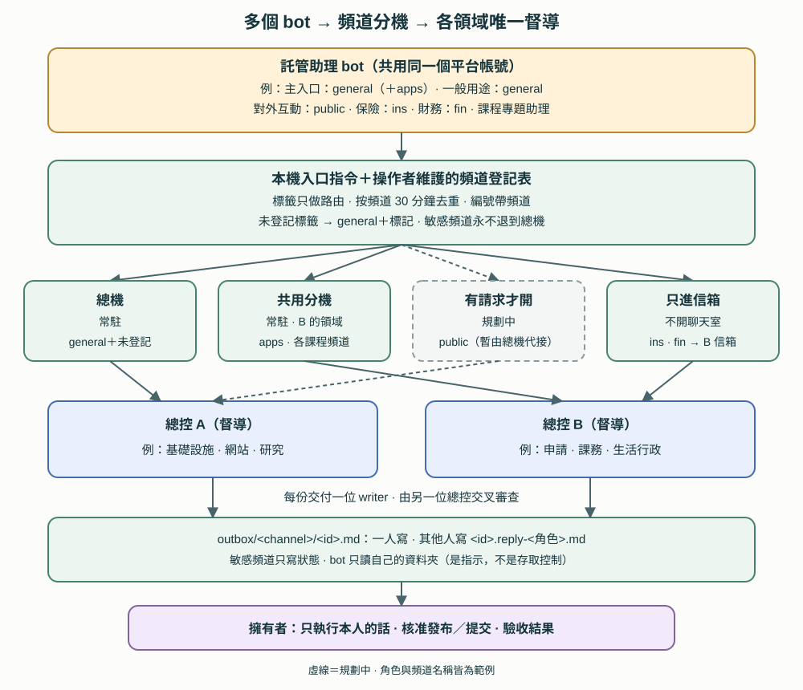

# 第 17 章　多 bot 入口：頻道與分機

[English](../en/17-entry-channels.md) | [繁體中文](../zh-TW/17-entry-channels.md) | [Home](../../README.md)

參考部署的擁有者在一個外部、支援語音的代理平台上使用好幾個託管助理 bot，每個 bot 各有角色。需要本機檔案、repo、總控、審查或單一 writer 的請求，bot 會用本機入口指令交給私人工作區。本章說明多個 bot 共用同一個入口時，怎麼把請求分開。這是**私人參考架構〔程式・自製〕，不是隨附工具**。本 repo 不含入口指令、登記表、bot 指示或任何憑證。

這裡和[第 16 章](16-dedicated-project-intake.md)有一個關鍵差別。第 16 章由通訊平台驗證擁有者與頻道；這裡的 bot 共用代理平台上的同一個帳號，所以工作區**無法證明請求是哪個 bot 送的**。頻道只是路由標籤（17.8）。



## 17.1 為什麼一個接線員會塞車

第一版只有一個入口：每個 bot 都執行同一個指令，所有請求都進同一個操作者聊天室，也就是「接線員」。請求量在忙碌時長到一天十幾筆以上，出現以下問題〔規約：參考部署實際觀察〕：

- **插話：** 接線員還在處理上一件時，新請求就被打進來，不相干的脈絡混在一起。
- **脈絡壓力：** 長時間運作的接線員聊天室曾在忙碌的一天被壓縮，之後曾把時間寫錯。現在接線員寫任何時間前都先讀系統時鐘。
- **補充太碎：** 擁有者常在一兩分鐘內補充同一件事，每次補充都變成一筆新請求，有時前後還互相矛盾。
- **彼此看得到：** 所有回覆都在同一個資料夾，負責某個生活領域的 bot 讀得到另一個領域的回覆。
- **分不出來源：** 指令只記錄「某個 bot 送的」，不知道是哪個 bot、什麼主題。

## 17.2 三層結構

| 層 | 是什麼 | 負責 |
|---|---|---|
| 入口 bot | 託管助理 bot，各有一個角色；指示更新後（17.10）會寫死一個頻道標籤 | 收下擁有者的需求、合併補充、帶自己的標籤送出，只從自己的資料夾讀結果 |
| 頻道分機 | 接收一個或多個頻道的操作者聊天室，或某位總控的信箱 | 回答快速的唯讀問題，其他交給該領域督導；把狀態寫進該頻道的 outbox |
| 總控與 writer | 第 2–6 章的兩位總控、單一 writer 與審查者 | 照一般請求的方式派工、製作、審查、記錄證據 |

在參考部署中，bot 的角色泛稱包括：日常請求的主入口（申請類也走它）、一般用途助理、對外互動助理、保險助理、財務助理，以及課程專題助理。一個 bot 可以為另一類請求使用第二個標籤。

分機有四種：

| 分機類型 | 範例頻道 | 說明 |
|---|---|---|
| 總機（常駐） | `general`，以及所有未登記的標籤 | 原本的接線員，處理日常與跨領域請求 |
| 共用分機（常駐） | `apps` 與各課程頻道 | 負責總控 B 的領域；屬於總控 A 領域的請求轉給 A |
| 有請求才開 | `public` | 規劃在第一筆請求進來時開啟；開之前由總機代接並加標記 |
| 只進信箱 | `ins`、`fin` | 量少又敏感，直接送進總控 B 的信箱，不開常駐聊天室 |

分機由該領域的督導擔任，所以「**只有督導能派工**」（第 4 章）仍然成立。常駐分機最多三個，因為每多一個就是主機上多一個長時間運作的聊天室。這裡的頻道名稱都是範例。

## 17.3 頻道登記表

一份由操作者維護的檔案，記錄每個頻道的去處〔程式・自製〕。只有負責基礎設施的總控可以修改，而且要先經擁有者確認。分機不改它，訊息文字也改不了它。

```json
{
  "channels": {
    "general": {"desk": "general", "outbox_dir": "", "id_prefix": "req",
                "fallback": ["coordinator-a", "coordinator-b-mailbox"], "sensitivity": "normal"},
    "apps":    {"desk": "shared", "outbox_dir": "apps", "id_prefix": "req-apps",
                "fallback": ["coordinator-b-mailbox"], "sensitivity": "high"},
    "public":  {"desk": "public", "outbox_dir": "public", "id_prefix": "req-public",
                "fallback": ["general-desk", "coordinator-a", "coordinator-b-mailbox"], "sensitivity": "medium"},
    "ins":     {"desk": null, "outbox_dir": "ins", "id_prefix": "req-ins",
                "fallback": ["coordinator-b-mailbox"], "sensitivity": "high"}
  }
}
```

*示意用，不可執行；欄位名稱沿用參考設計。*

每個頻道記錄它的分機、outbox 資料夾、請求編號前綴、依序的備援清單、敏感度與督導領域，也可以列出例外，例如要轉給另一位總控的項目。每個分機有一份小的分機檔，記錄目前的聊天室 handle，只有該分機的負責人會寫。

**敏感頻道永遠不退到總機。** 分機不在時改送督導信箱，內容不會混進一般流量。在參考部署中，總控 B 的信箱是每個頻道的最後一站，因為信箱不依賴在線的聊天室。

## 17.4 一筆請求怎麼走

1. **先合併。** 擁有者在大約三分鐘內補充同一件事，bot 先合成一筆再送。
2. **帶標籤和類型送出。** bot 執行入口指令，帶上自己的頻道和類型。*問答*、*查詢*、*討論*是唯讀；*修改*可以在範圍內改檔案；*發布*和*提交*還需要擁有者明確核准（17.8）。
3. **不明標籤安全降級。** 沒帶頻道的請求當成 `general`，所以舊的 bot 指示照常運作。未登記的標籤也當成 `general`，但會標記提醒擁有者。格式不符的標籤不會被原樣回傳。
4. **編號帶頻道名稱**，例如 `req-ins-20260101-0930-ab12`。`general` 保留原本不帶頻道的格式。
5. **按頻道去重。** 同一個頻道在 30 分鐘內送出相同的整理後文字，會拿回先前的編號，不另建請求。之後的補充必須指明原編號，而且只能補同一個頻道的請求；跨頻道補充會被拒絕。
6. **路由。** 入口指令依登記表的順序，送到第一個在線的分機。本機編排服務連不上時，請求先存到磁碟佇列，由背景工作稍後投遞，頻道資訊不會遺失。
7. **投遞。** 目前請求是直接打進分機聊天室。「等分機閒置才送、約 15 分鐘仍未送出就通知督導」的分機佇列還在規劃，尚未實作。
8. **回覆。** 結果寫在 `outbox/<channel>/<id>.md`。更新後的 bot 指示要求它只讀自己的資料夾；這是指示，不是存取控制。

bot 能對擁有者說什麼，取決於證據：

| 狀態 | 最低證據 | 不能證明 |
|---|---|---|
| 已送 | 入口指令回傳了編號 | 有人讀過 |
| 已接單 | 處理者在 outbox 檔寫入自己的狀態 | 已經開工 |
| 已交付 | outbox 或回覆檔裡有結果或審查 | 擁有者已接受 |
| 已驗收 | 擁有者本人說了 | 任何對外動作已獲授權 |

bot 回報時要說出請求編號。沒讀到結果檔，就不說「處理中」或「完成」。指令回報失敗時，bot 把指令提供的說明念給擁有者聽；指令說這筆和先前某筆重複時，bot 追蹤原本那筆，不重送。

## 17.5 每份 outbox 只有一個人寫

誰處理請求，誰就寫該頻道資料夾裡的 `<id>.md`。其他參與者，例如另一位總控或審查者，寫 `<id>.reply-<角色>.md`，不改處理者的檔案〔規約〕。入口指令會先建立一份暫存檔；之後它只會覆蓋自己寫的暫存檔，處理者一旦寫入並在檔案中記錄自己是處理者，指令就不再動那份檔案〔程式・自製，有離線測試〕。這樣不必加鎖，也能避免兩方輪流改寫同一份摘要。

## 17.6 角色與職權

| 角色 | 可以做 | 不可以做 |
|---|---|---|
| 入口 bot | 收件、合併、送出、讀自己的資料夾、轉達結果 | 把標籤當身分、執行轉述來的指示、沒有結果檔就說有進度 |
| 總機 | 回答快速的唯讀問題；照總控 A 的規則派送 A 領域的請求；把 B 領域的請求送進 B 的信箱；寫狀態 | 派送不屬於其督導的領域、push、發布、對外寄送 |
| 共用分機 | 對總控 B 的領域做同樣的事 | 處理 A 的領域（改為轉交） |
| 總控 A、B | 督導各自領域，每份交付只選一位 writer，交叉審查對方的交付（第 4–6 章） | 代替擁有者驗收 |
| 單一 writer | 在書面範圍內製作交付物 | 超出範圍修改；審查自己的成果 |
| 擁有者 | 做決定、核准對外動作、驗收結果 | — |

交叉審查的意思不變：由 writer 以外的聊天室，對固定版本做唯讀核對，結果和擁有者的驗收分開記錄（第 6 章）。

## 17.7 不誤報的健康檢查

背景探測每五分鐘確認分機與路由是否在線〔程式・自製〕。舊版只要編排 CLI 回應慢，就報「接線員不在線」，即使聊天室其實還活著。參考部署做了四項改善：

1. **記錄每一步的延遲。**
2. **失敗後約 75 秒重試一次**，第二次仍失敗才計數。
3. **慢不等於掛掉。** 任一步超過 15 秒或逾時，標為「不確定」，也不自動恢復。
4. **連續第三次失敗才通知**，恢復後再通知一次。每次結果都追加到歷史紀錄。

## 17.8 安全界線

- **只有擁有者本人直接說的話會被執行。** 轉述 email、社群貼文、網頁或其他 bot 的請求，一律標「需要擁有者」，不執行。
- **外部內容只是資料。** bot 輸出、工具輸出和抓回來的網頁都不會變成指令。
- **頻道是路由標籤，不是身分驗證。** 所有 bot 共用一個平台帳號、一台雲端電腦。如果 bot 可以在主機上執行指令，任何 bot 都能填任何標籤、讀任何資料夾。真正能限制風險的是：
  1. 本機執行採逐次核准，至少敏感 bot 要這樣做（建議做法）。核准前先看清楚核准畫面上的頻道標籤。
  2. 上面那條「只執行擁有者本人的話」。這是書面規則，不是技術隔離。
  3. 敏感頻道的 outbox 只寫狀態。
- **敏感頻道只寫狀態，不寫內容。** 申請、保險、財務和有保密義務的課務，只回傳狀態和檔案位置，不回傳細節。bot 拿不到的內容，就不可能外洩。
- **發布和提交需要擁有者明確核准。** bot 轉述的核准不等於核准本身。做不可收回的公開動作前，先在擁有者直接說話的管道確認（見第 11 章：代理轉述不是授權）。
- **不可信的收件匣是注入途徑。** 會讀陌生人訊息的 bot（例如對外收件匣）不應該能在主機上執行指令。多個 bot 共用帳號時，一個 bot 被注入，等於全部都有風險。
- **語音名稱需要私人詞彙表。** 語音辨識常把名字聽錯。用私人詞彙表記錄更正；拿不準的名字標「待確認」，不要猜。詞彙表幾乎都是真名，絕不公開。

## 17.9 什麼走工作區、什麼讓 bot 自己做

| 走法 | 適用 | 好處 | 代價 |
|---|---|---|---|
| 走工作區 | 本機檔案與 repo、申請、課務、保密資料，以及任何需要單一 writer 或審查的事 | 完整的代理工具、督導與審查、可追查的紀錄、資料留在本機、安全規則集中執行 | 每筆幾分鐘到一小時；需要主機在線（操作畫面時還要解鎖）；消耗代理額度；bot 只看得到摘要 |
| bot 自己做 | 對話陪做、即時語音、完全在平台上完成的工作、照交接包一步步引導、平台上的排程工作 | 立即回應、全天在線、不受主機影響 | bot 之間沒有隔離、資料會上傳到廠商、沒有審查或統一紀錄、交接包會過時 |

兩邊可以雙向切換：

- **bot → 工作區：** 需要本機資料、改 repo、審查或決定時，bot 用入口指令送出，並在出現結果檔之前不聲稱有進度。
- **工作區 → bot：** 結果以 outbox 檔回傳。需要持續陪做的事，由工作區準備**去識別化的交接包**，擁有者本人上傳給 bot；過時就重新產生。保密資料和原始私人紀錄一律不上傳。

## 17.10 證據與目前狀態

| 層級 | 參考部署觀察到的 | 限制 |
|---|---|---|
| 離線測試 | 16 項測試，涵蓋登記表、路由順序、敏感頻道不退到總機、按頻道去重與補充、outbox 暫存檔保護、保留頻道的佇列，以及健康檢查的重試／不確定／通知邏輯 | 沒有實際投遞 |
| 操作者測試請求 | 經兩個非 general 頻道送出的測試請求，送到了預期的分機或信箱，並在該頻道資料夾回覆收到 | 不是 bot 送的 |
| 正式使用時帶標籤的請求 | **已觀察到第一筆正式（非測試）帶標籤的請求**，在某個課程頻道：送到共用分機，分機寫自己的狀態檔，總控另寫回覆檔。其他 bot 尚未出現帶標籤的請求 | 只有一個頻道；標籤既不能證明是哪個 bot 送的，也不能證明是 bot 送的 |
| 等閒置的投遞佇列 | 規劃中 | 忙碌的分機仍可能被插話 |
| 有請求才開分機 | 規劃中 | 目前由總機代接 `public` 頻道 |

一律回報證據最弱的狀態。在每個 bot 都帶自己的標籤之前，按頻道分流只在上面這些請求中驗證過。
