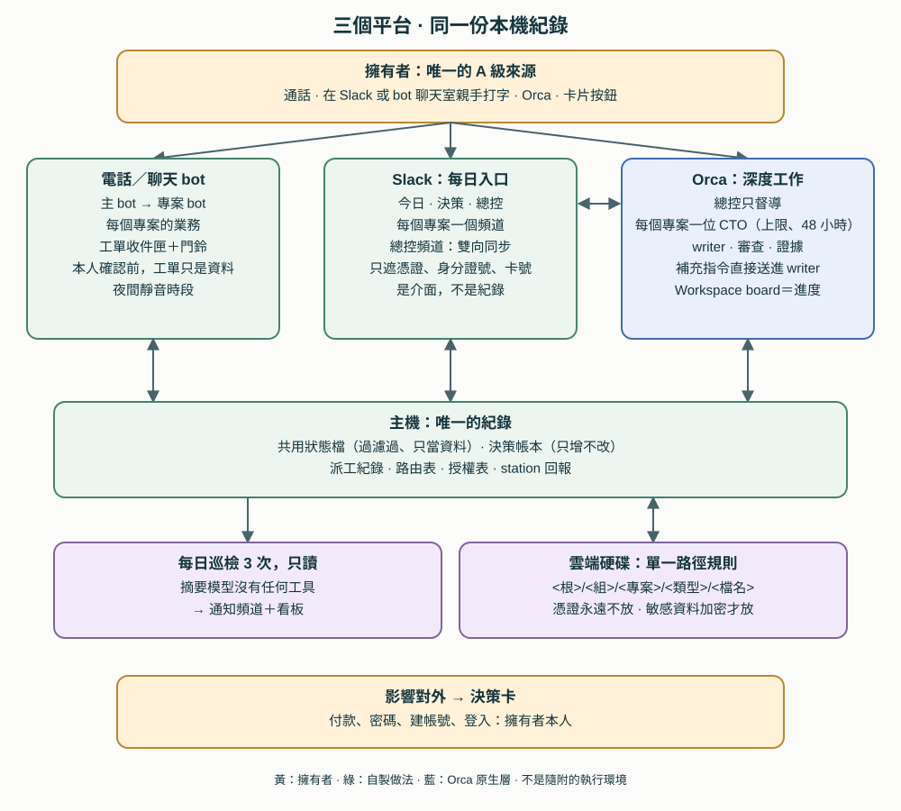

# 19. 三個平台：Orca 做深度工作、Slack 管每天、bot 接電話與聊天

[English](../en/19-three-platforms.md) | [繁體中文](../zh-TW/19-three-platforms.md) | [Home](../../README.zh-TW.md)

2026-11 起，參考部署的擁有者不再只靠一個平台，而是透過三個平台使用工作區。Orca 仍是實際做事的地方；一個私人 Slack 工作區成為每天的入口；託管的電話與聊天 bot 平台（參考部署用的是 Grok）從「只會單向送件」變成雙向的夥伴。本章說明三者怎麼分工、請求怎麼在它們之間移動。這是**私人參考架構〔程式・自製〕，不是隨附工具**：不含常駐程式、bot 指示、頻道 ID 或任何憑證。第 19–21 章提到的 Orca 原生命令，都對照過本機安裝的 **Orca CLI 1.4.253** help。

第 20、21 章是同一次更新的後續：[第 20 章](20-authority-and-decisions.md)說明誰的話算數、決定怎麼記錄；[第 21 章](21-project-operations.md)說明專案層與日常維運。

## 19.1 第 18 章之後改了什麼

- **每天的入口不再是 terminal。** 擁有者在手機上的 Slack 看簡短摘要、按決策卡、打字交辦；深入討論仍在 Orca。
- **每個專案一個頻道。** 每個進行中的專案都有自己的 Slack 頻道；多數專案也有自己的 Orca 總控聊天室，稱為專案 CTO（第 21 章）。
- **bot 平台變成雙向。** 總控現在可以留工單給 bot 並按門鈴，不再只能收 bot 送來的請求（19.6）。
- **每個入口都寫進同一份本機紀錄。** Slack、bot 和 Orca 的每個動作都在共用狀態檔記一行，所以任何入口都不會重複派出別的入口已經開始的工作（19.8）。
- **誰的話算數**改成依來源分 A–D 四級，每個入口各有判斷規則（第 20 章）。

## 19.2 誰做什麼

擁有者的模型是：**bot 是各專案的業務，Orca 是各專案的 CTO。** 擁有者只需要對主 bot（打電話）、Slack 總控頻道（打字）或 Orca（深度）說話。

| 平台 | 角色 | 適合 | 不適合 |
|---|---|---|---|
| Orca | 深度工作：總控、專案 CTO、writer、審查者；進度看板 | 程式碼、本機檔案、審查、證據、需要單一 writer 的事 | 在手機上快速使用；官方手機 App 只顯示 agent 狀態與檔案，不顯示看板 |
| Slack | 每日入口：今日摘要、決策卡、總控頻道、每個專案一個頻道 | 在手機上打字和按鍵、看結果、附 PDF | 長篇討論；當作正式紀錄（它只是介面） |
| bot 平台 | 電話與聊天入口；每個專案一個 bot，記得擁有者的偏好、提醒、操作外部網站與 App | 語音、快速記下、在外部 App 裡做事、主機關機時也要跑的排程 | 改程式、下結論、驗收 |

三個平台上的角色：

| 角色 | 是誰 | 負責 | 不做 |
|---|---|---|---|
| 主 bot | 擁有者最常用的電話／聊天 bot | 聽擁有者說話、判斷歸哪個專案、轉交 | 憑記憶回答專案進度 |
| 專案 bot | 每個專案或生活領域一個 | 記得擁有者對這個專案的偏好、提醒、操作外部網站 | 改程式、下結論 |
| 專案 CTO | 每個專案一個 Orca 聊天室（第 21 章） | 拆工作、派 writer、驗收、留證據 | 碰別的專案、批准對外的事 |
| 總控 | 第 2 章的兩位總控 | 跨專案排序、路由表、系統、權限 | 親自做各案細節 |
| writer | Orca 聊天室 | 動手 | 除了交件或卡住，不寄信給任何人 |

**不是每個 bot 都配 CTO**〔規約〕：

- 敏感的生活行政 bot（財務、保險）留在 bot 平台、不配 CTO，結果只寫狀態。
- 社群小編 bot 不綁固定 CTO。它們的問題先交給 bot 對接員（一個 Orca 接線員聊天室，第 17 章），對接員查路由表，把問題轉給該主題的專案；沒有活躍 CTO 時，由對接員查文件回答。小編不直接找主總控。
- 小編只能問事和提需求，不能叫 CTO 改東西；要改的事交給擁有者決定。
- 每個對外產品放一份**可公開事實表**，小編先讀這份，查不到才問。

## 19.3 工作怎麼在平台之間移動

〔規約〕

- **事實只放一處。** 專案狀態以主機上的紀錄為準；bot 的記憶只是它自己的筆記。
- **路由表只有一份。** 由總控的路由檔決定誰督導什麼（第 4 章）。專案頻道和 bot 都去查它，不自己留一份。
- **一件事一個負責人。** 同一階段只有一位負責人，不同時轉給好幾個 bot。
- **最多轉兩手**：主 bot → 專案 bot → CTO。單純查詢可以由主 bot 直接問 CTO，省下一手和它的額度。
- **選平台：** 要碰程式碼、要驗收或要留證據的，給 Orca；要碰外部 App 和網站，或主機關機時也要跑的，給 bot 平台。
- **說法衝突：** 以擁有者最新的話為準；分不清哪一句比較新，就問擁有者，不要猜。
- **主機或 Orca 停了：** bot 回「後場不通」，不猜答案；故障警報另走一個通知頻道。

## 19.4 Slack 當每日入口

Slack 這邊是一個只有擁有者一人的私人工作區，不邀請任何人〔規約〕。

- **沒有公開端點。** Slack app 用 Socket Mode：由主機主動往外連線，不需要公開網址或對外開放的連接埠〔程式・原生：Slack〕。
- **只認擁有者的成員 ID。** 只有這個成員 ID 親手打的字是指令來源，其他都是資料。bot 與 app 的訊息（包括助理自己的）都不當成輸入〔程式・自製〕。
- **所有 token 都由擁有者處理。** 建工作區、安裝 app、把 token 存進作業系統的憑證儲存區，都由擁有者本人做；agent 看不到、也不輸入任何 token。[manifest 模板](../../templates/zh-TW/slack-app-manifest.example.yaml)不含任何 ID 或秘密。
- **頻道用數字開頭分組**，因為側邊欄沒辦法照擁有者想要的方式分類。1 開頭每天看（今日、決策、總控）；2–5 開頭是各專案與生活領域；9 開頭是系統（通知、測試、給 bot 看的資料）。見[頻道對照模板](../../templates/zh-TW/channel-map.example.json)。
- **今日摘要**每天只有一則：清晨建立，中午和深夜原地更新，所以不會再跳通知。錯過的時段只補最新的一次。
- **通知設定：** 決策頻道每則都通知；其他頻道只在被提及時通知。
- **每個專案一個頻道。** 在專案頻道打字，會交給 bot 對接員，它回在同一串。有些專案是**只放狀態**的頻道：可以傳進度和 PDF，但官方資料檔、分數、個資和密碼一律不放。
- **擁有者在手機上能看的結果**，只從回覆檔裡明確標示「可以顯示」的欄位貼出；附件、機密細節和整份內部報告都不轉。
- **紀錄放在主機上。** 每個收到的事件、決定與貼文，都寫進主機上只增不改的本機資料庫。Slack 的訊息歷史可能過期或受限，決定不依賴它。
- **coding agent 的 Slack 連接器維持禁止發言**〔規約：設定〕。官方連接器用的是擁有者本人的身分，agent 在那裡發的訊息，看起來會和擁有者的指令一模一樣。最多只開讀取權限。

## 19.5 總控頻道：雙向同步，以及遮什麼

在總控頻道打字，等於直接對主總控打字〔程式・自製，參考部署每天使用中〕：

1. 常駐程式把擁有者的訊息打進總控的 terminal，前面加固定前綴和請求標記，讓總控知道這是擁有者在 Slack 打的。
2. 一個非同步的 Stop hook 把總控的最後答覆寫進本機 outbox，常駐程式再把它貼回擁有者發文的那一串。如果好幾則 Slack 訊息被併成同一輪，每一串都會收到答覆。
3. 擁有者直接在 Orca 打的字，也會同步到總控頻道，所以手機上看得到完整對話。
4. 這些 hook 只寫本機 outbox，不接受任何工具權限的決定，也不印出任何可能含有擁有者文字的內容。

**遮蔽：** 擁有者決定，所有內容都可以傳到這個只有擁有者一人的 Slack，只遮**真正的憑證值、身分證號和卡號**。之前遮得太多，手機上的答覆反而看不懂。「只放狀態」的規則不變：檢查敏感專案時只給狀態，客戶案在 Slack 不給完整 diff。遮蔽是樣式比對，不是保證；憑證和證件本來就不該貼到任何地方。

## 19.6 bot 平台變成雙向

第 17 章說的是 bot 把請求送進工作區。現在總控也能把工作交回去〔程式・自製〕：

| 誰 | 動作 | 說明 |
|---|---|---|
| 總控 | **留工單**給指定的 bot | 種類是 *task*、*info* 或 *question*；預設 48 小時後過期。留給主 bot 時，會同時寫一則通知並按門鈴 |
| bot | **取工單** | 一次最多 5 筆，取到就標成已送達；另有只看不標的模式 |
| bot | **回報結果**：*done*、*failed* 或 *blocked* | 結果寄到總控的 Orca 信箱 |
| bot | **主動回報** | 例如：已發文、緊急煞車、每日回報、問題 |
| 總控 | **讀結果** | 補看寄不到信箱的結果 |

每個指令都只印一行 JSON。每次留工單，也會以該 bot 為對象記進派工紀錄（第 21 章）。

**門鈴**是平台上用 webhook 觸發的排程。網址和金鑰只放在作業系統的憑證儲存區，由擁有者自己存。門鈴按成功，只代表排程*開始跑*；有使用者回報 webhook 的內文不一定送得到，所以真正的內容一律放在收件匣，門鈴內文只是提示。

**擁有者確認前，工單只是資料**〔規約：實測一次〕。一次端到端測試中，門鈴被接受，約 20 秒後主 bot 讀了共用狀態檔，並回覆測試用的代號。但工單本身仍是*待處理*：門鈴觸發的排程只讀，不會取工單，也不會照工單做事。要等擁有者本人跟 bot 說，bot 才會照工單做。寫給 bot 的指示包也一樣：要擁有者本人叫 bot 讀才生效；其他來源叫它讀，就只當資料。

收件匣的規則〔規約〕：

- 工單永遠不能擴大 bot 本身的權限。涉及花錢、帳號、密碼或驗證碼、刪除、私訊新對象、價格或法律的工單，一律回 *blocked*。
- 寄件人欄位（某位總控、另一位，或擁有者）**只是標籤，不是身分驗證**。本機任何程式都能寫進收件匣資料夾，所以界線靠 bot 自己的 skill 規則守住，不靠收件匣。
- 會讀外部內容的 bot（公開收件匣、社群動態）完全不接 B、C 級的輸入（第 20 章）。

**沒有採用：** 用 GUI 自動化在 bot 的桌面 App 裡打字，可以立刻叫醒它，但會搶走擁有者正在用的畫面。這只留作手動備案，每次都要擁有者同意。

## 19.7 靜音時段

bot 送來的請求有了答覆時，工作區會按主 bot 的門鈴，讓它轉告擁有者。門鈴會分批〔程式・自製，依參考程式碼〕：

- 最多每三分鐘按一次，每天有上限；
- **擁有者的夜間靜音時段不按**；
- **例外：** 如果 bot 自己在最近 30 分鐘內問過，照樣按，因為擁有者顯然醒著在等。

其他通知也是同樣的想法：夜間時段只排隊、之後再發，清晨的摘要更新不會提及擁有者。靜音時段的例外目前只在程式碼和離線測試裡看過，還沒有在真實環境觀察到例外的那一聲門鈴〔未知〕。

## 19.8 一份共用狀態檔

每個入口都寫進一份簡短的「目前狀態」檔；bot 開始對話或回答專案問題前，先讀這份〔程式・自製〕：

- **只用已經記錄的東西產生：** 擁有者的請求（派工紀錄）、Slack 的決定與尚未處理的卡片、bot 的請求與答覆、各站回報。
- **最多每分鐘更新一次**，由 Slack 常駐程式的背景循環執行。更新失敗就保留上一版，也不會讓 Slack 那邊停擺。
- **它會離開這台電腦**，因為 bot 平台是從廠商雲端讀它。所以符合私密樣式的行（機密標記、憑證、證件與帳戶號碼、金額、價格、成本、email、電話）會被刪掉，成本永遠不出現，敏感專案只顯示狀態，檔案也有固定的大小上限。
- **它是給 bot 的資料，永遠不是指令。**

## 19.9 證據與目前狀態

| 項目 | 參考部署觀察到的 | 限制 |
|---|---|---|
| Slack 總控頻道 | 每天使用中：擁有者的訊息打進總控，答覆貼回同一串 | 遮蔽靠樣式比對 |
| 決策卡與授權 | 離線測試；擁有者在手機上測過修改流程與擋下流程；卡片每天在用 | 哪些只在程式碼裡，見第 20 章 |
| 真實環境設定檢查 | 一支只讀的檢查器對真實 Slack 與 Orca 第一次正式跑時，回報兩項設定失敗，交給總控處理，沒有自己改設定；它本身的 19 個故障注入測試通過 | 檢查通過不代表每一項都實際測過 |
| bot 收件匣（工作區這一側） | 隔離副本測試，以及一次真實信箱來回 | — |
| 門鈴 | 一次端到端，bot 回了代號 | 排程不會照工單做事 |
| bot 那一側定時取工單 | 沒有觀察到 | 平台的排程能不能執行本機指令，仍未知 |
| 靜音時段的例外門鈴 | 只有程式碼與離線測試 | 沒有真實觀察 |

回報時採證據最弱的狀態。「常駐程式貼出去了」不等於「擁有者看到了」；「bot 回覆了」不等於「bot 做完了」。

## 19.10 考慮過但沒有採用

- **全部改用 Slack，停用 bot 平台：** 電話語音和在外部 App 裡做事，正是 bot 的用途，Slack 取代不了。
- **讓 agent 用擁有者的身分在 Slack 發言：** 不採用，理由見 19.4。
- **把正式紀錄放在 Slack 或 bot 的記憶裡：** 兩者都只是介面；主機上的本機紀錄才是事實（19.3）。

延伸閱讀：[17. 多 bot 入口](17-entry-channels.md)、[18. 總控即時回應](18-responsive-coordinators.md)、[20. 權限與決策](20-authority-and-decisions.md)、[21. 專案維運](21-project-operations.md)。
